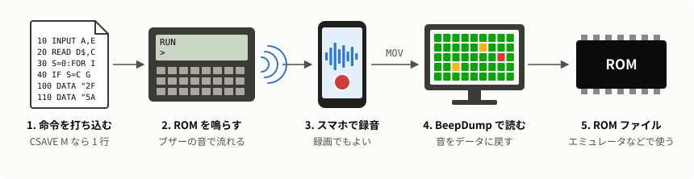
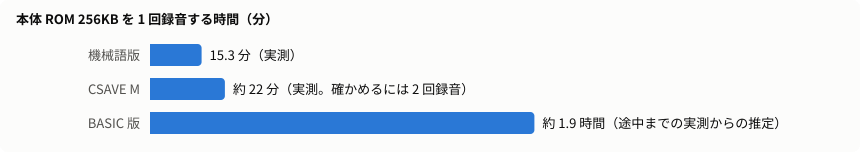
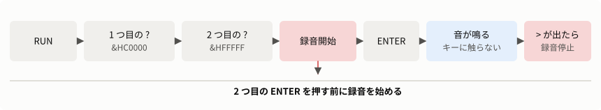
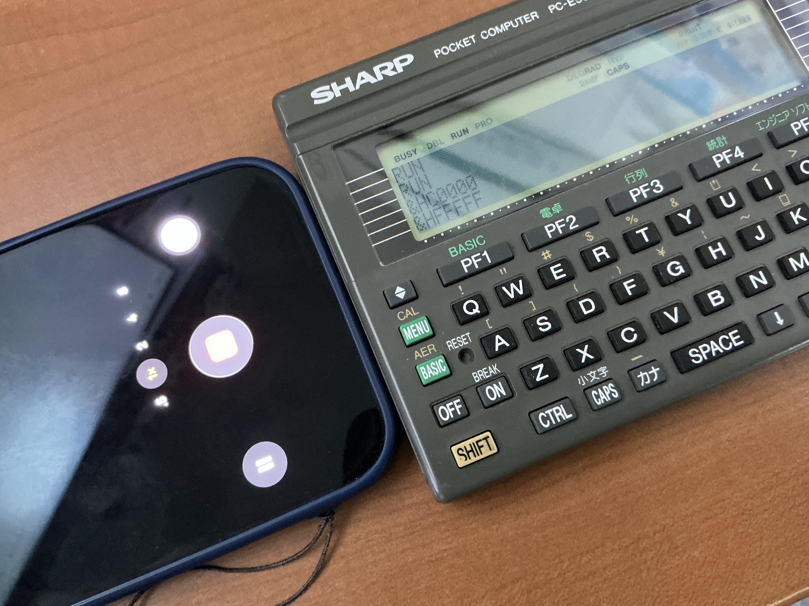
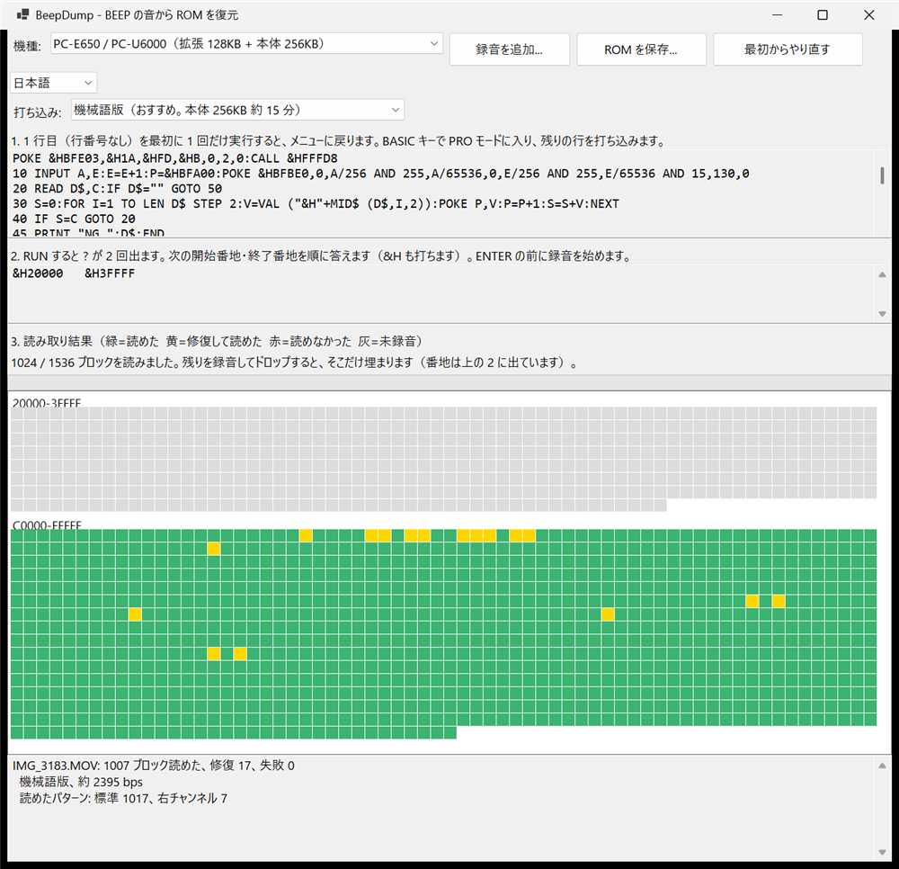
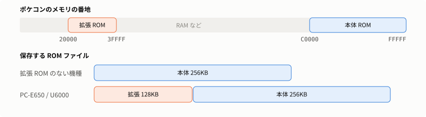
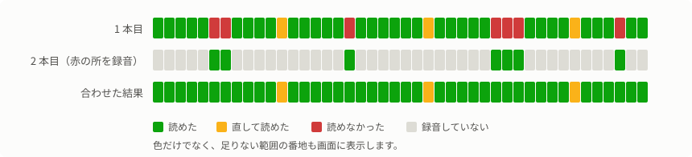

# PC-E500 BEEP ROMDump — 音で ROM を吸い出す

[English](README_en.md)

PC-E500 シリーズの内蔵 ROM を、周辺機器なしで PC に取り出します。短いプログラムをポケコンに打ち込んで ROM の中身をブザーで鳴らし、スマホで録音または録画して、PC のアプリで ROM ファイルに戻します。



## 実験的なアプリケーションです

**これは実験的なアプリケーションで、まだ十分に検証されていません。** 自己責任で使ってください。動作の保証はありません。

- **実機での確認はごくわずかです。** 機械語版は PC-E500 と PC-U6000 の各 1 台で、1 回ずつの録音を読みました。その結果は、`PC-E500(3.2).ROM` と `PC-U6000(8.4).ROM`（384KB）に全バイト一致しました。BASIC 版は PC-E500 で途中までです。PC-E650 などほかの機種は、実機で動かしていません。
- **録音機材は iPhone の動画だけです。** ほかの機材は、録音を加工した試験でしか確かめていません。読み取りの調整も、この数本の録音に合わせたものです。
- **読めたデータが必ず正しいとは言えません。** 確かめられるのは検査値までです。比べる ROM がない版では、誤りが残っていても気づけません。実際に開発中、BASIC 版で誤ったデータが検査を通ったことがあり、対策はしましたが、なくなったとは言い切れません。確実を期すなら、機械語版を使い、2 回録音して一致を確かめてください。
- **大事なデータは先に退避してください。** 機械語版は、打ち間違いを見逃すと暴走してリセットが必要になるおそれがあります。長く鳴らすので、新しい電池か AC アダプタを使ってください。
- **動かしていない環境があります。** macOS 版、Linux の Arm64 版、本物の ffmpeg での読み込みは未確認です（[インストール手順](docs/INSTALL.md)）。

うまくいかないときや、確かめられたことがあれば、[Issues](https://github.com/litchi-gh/pc-e500_beep_romdumper/issues) で教えてもらえると助かります。

## 対応機種

**SHARP のポケットコンピュータ PC-E500 シリーズ専用です。** CPU に SC62015（ESR-L）を搭載した次の機種で使えます。これ以外のポケコン（PC-1350 や PC-G850 など）には使えません。

| 機種 | 確かめた ROM の版 | 読む ROM | 保存するファイル | 実機での確認 |
|---|---|---|---|---|
| PC-E500 | 2.2、3.2、5.3、6.3、7.2 | 本体 | 256KB | 版 3.2 で機械語版は全部、BASIC 版は途中まで |
| PC-E500PJ | 6.2 | 本体 | 256KB | なし |
| PC-1480U | 2.1 | 本体 | 256KB | なし |
| PC-1490UII | 6.4 | 本体 | 256KB | なし |
| PC-E550 | 7.5 | 本体 | 256KB | なし |
| PC-E650 | 8.5 | 本体 + 拡張 | 384KB | なし |
| PC-U6000 | 8.4 | 本体 + 拡張 | 384KB | 版 8.4 で機械語版を全部 |

- **エミュレータでの確認:** 表の 7 機種 11 版すべてで両方のプログラムを動かし、出た音を BeepDump で読んで ROM と比べました。機械語版は試した 8 ブロックがすべて一致し、BASIC 版は読めたブロックに誤りがありませんでした（RAM 32KB と 64KB で確認。PC-E650 と PC-U6000 は 64KB のみ）。試したのは ROM の末尾の一部だけで、エミュレータは実機と時間が違います。
- **表にない機種や版:** 動くかもしれませんが、確かめていません。

版は BASIC で調べられます。`7  2` と出たら版 7.2 です。

```basic
PRINT PEEK &HFFFF0;PEEK &HFFFF1
```

## どちらの版を使うか

**おすすめは機械語版です。** プログラムは 2 種類あり、アプリはどちらの音でも自動で判別して読みます。

| | 機械語版（おすすめ） | BASIC 版 |
|---|---|---|
| 打ち込む量 | 18 行・約 790 文字 | 2 行・約 170 文字 |
| 本体 ROM 256KB の時間 | **15.3 分**（実測） | 約 1.9 時間（途中までの実測からの推定） |
| 1 回の録音で読めた割合（実機） | **全部**（PC-E500、PC-U6000） | 約 96%（残りは録り直して足す） |
| 打ち間違えたとき | ほとんどは `RUN` で `NG` と出る。見逃すと暴走してリセットが必要になるおそれあり | エラーで止まるか、読めない音になる |



## 用意するもの

- PC-E500 シリーズのポケコン（[対応機種](#対応機種)）
- 録音または録画できるスマホ（iPhone の録画で確認しました）
- PC とアプリ（[動作環境](#動作環境)）。Windows なら [Releases](https://github.com/litchi-gh/pc-e500_beep_romdumper/releases) の `BeepDump.exe` 1 つで動きます

アプリの用意のしかたは [インストール手順](docs/INSTALL.md) を見てください。Linux と Mac で必要になる ffmpeg の入れ方も書いてあります。

## 動作環境

### アプリ

| | 画面のあるアプリ（`BeepDump.exe`） | コマンドライン版（`beepdump`） |
|---|---|---|
| OS | Windows 11（64 bit） | Windows 11（64 bit）、Linux（x64、Arm64）、macOS 15 以降（Intel、Apple Silicon） |
| 表示の言語 | 日本語、英語 | 英語 |
| .NET のインストール | 不要 | 不要 |
| 読める録音 | MOV、MP4、M4A、WAV など（Windows の Media Foundation で読めるもの） | WAV はどの OS でも。ほかは Windows ではそのまま、Linux と macOS では `ffmpeg` が必要 |
| 確認した環境 | Windows 11 Pro | Windows 11 Pro、Linux（WSL の Ubuntu 26.04、x64） |

- **動かしていないもの:** macOS 用と Linux の Arm64 用は、ビルドしただけで動かしていません。上の OS は .NET 10 の[対応 OS](https://github.com/dotnet/core/blob/main/release-notes/10.0/supported-os.md)から書いたものです。Linux は glibc 2.27 以降が必要で、Alpine（musl）用は用意していません。
- **Windows 10:** .NET 10 の対応は LTSC と Enterprise のエディションに限られます。動作は未確認です。
- **Windows の N エディション:** Media Foundation が入っていないので、MOV などを読むには Media Feature Pack が必要です（未確認）。WAV はそのまま読めます。
- **メモリ:** 15 分の録音で約 2GB 使います。録音が長いほど多く使います。BASIC 版の本体全部（約 1.9 時間）の録音は未確認です。
- **解析の時間:** Core i5-1235U（10 コア）、メモリ 16GB で、きれいな 15 分の録音が約 20 秒、読みにくい録音で数分です。CPU のコアを全部使います。

### ポケコン

[対応機種](#対応機種)を見てください。周辺機器は要りません。長く鳴らすので、新しい電池か AC アダプタを使ってください。

### 録音機材

スマホなど、上の形式で保存できるものなら使えます。確認したのは iPhone の動画（48 kHz、ステレオ）です。ボイスメモ（M4A）は未確認です。

## 手順

### 1. プログラムを入れる

ポケコンの画面（40 文字）に合わせて折り返したリストの画像もあります。打ち込むときは、こちらが見やすいと思います。折り返しでは ENTER を押しません。

- 機械語版: [BEEPFAST.png](BASIC/BEEPFAST.png)
- BASIC 版: [BEEPDUMP.png](BASIC/BEEPDUMP.png)

#### 機械語版（おすすめ）

1. BASIC を起動し、次の命令（行番号なし）をそのまま実行します。機械語の領域を確保する命令で、一度実行すれば十分です。実行するとメニューに戻ります。

   <pre style="font-size:1.25em; white-space:pre-wrap"><code>POKE &amp;HBFE03,&amp;H1A,&amp;HFD,&amp;HB,0,2,0:CALL &amp;HFFFD8</code></pre>

2. BASIC キーで BASIC に入り、もう一度押して PRO モードにします。
3. 次のリストを打ち込みます。

<!-- list:BEEPFAST.TXT skip=1 -->

<pre style="font-size:1.25em; white-space:pre-wrap"><code>10 INPUT A,E:E=E+1:P=&amp;HBFA00:POKE &amp;HBFBE0,0,A/256 AND 255,A/65536,0,E/256 AND 255,E/65536 AND 15,130,0
20 READ D$,C:IF D$="" GOTO 50
30 S=0:FOR I=1 TO LEN D$ STEP 2:V=VAL ("&amp;H"+MID$ (D$,I,2)):POKE P,V:P=P+1:S=S+V:NEXT
40 IF S=C GOTO 20
45 PRINT "NG ";D$:END
50 CALL &amp;HBFA00
100 DATA "2FB637D9E8FB0B000C00FA0BCC018008",1609
110 DATA "5A0464FA0456FA8CE0FB0B3065FF081A",1848
120 DATA "2708A50464FAFD544D66CC01000456FA",1627
130 DATA "B637B537CC010690270477FA7D011B09",1402
140 DATA "8DE3FB0B4D541B2D3071FD8FD100E8FB",2112
150 DATA "0B96273F9F079024455045650477FA7D",1426
160 DATA "011B0D063071FD8F750B401FEF08009F",1233
170 DATA "0477FA0477FA74CC00083069FD100490",1644
180 DATA "FAF41E043069FD100490FA7D001B1506",1527
190 DATA "8BE6FB0BEF06",876
200 DATA "",0</code></pre>

<!-- /list -->

4. BASIC キーで RUN モードに戻ります。

CE-140F（またはその代わりになるもの）があれば、3 の代わりに RUN モードで読み込めます。読み込むファイルは [BASIC/BEEPFAST.BAS](BASIC/BEEPFAST.BAS) です。

<pre style="font-size:1.25em"><code>LOAD "X:BEEPFAST.BAS"</code></pre>

#### BASIC 版

BASIC に入って PRO モードにし、次のリストを打ち込んで、RUN モードに戻ります。CE-140F（またはその代わりになるもの）があれば、打ち込む代わりに RUN モードで [BASIC/BEEPDUMP.BAS](BASIC/BEEPDUMP.BAS) を読み込めます（`LOAD "X:BEEPDUMP.BAS"`）。

<!-- list:BEEPDUMP.TXT skip=0 -->

<pre style="font-size:1.25em; white-space:pre-wrap"><code>10 INPUT A,E:FOR I=1 TO 99:NEXT
20 S=A/256 AND 255:BEEP 1,A/5000,8:FOR A=A TO A+255:BEEP 1,PEEK A,8:S=S+PEEK A:NEXT:BEEP 1,S-32768 AND 255,8:BEEP 1,S/257,8:IF A&lt;E GOTO 20</code></pre>

<!-- /list -->

### 2. 録音する

録画でもかまいません。使うのは音声だけなので、画面が映っていなくても大丈夫です。



1. スマホをブザーの近くに置きます。静かな部屋で、なるべく動かさないでください。音が小さめでも読めます（PC-U6000 は PC-E500 の約 1/7 の音量で全部読めました）。

   

2. `RUN` を実行します。`?` が 2 回出るので、次の番地を `&H` を付けて答えます。**2 つ目の ENTER を押す前に、録音を始めます。**

   | 読む範囲 | 1 つ目の `?` | 2 つ目の `?` | 機械語版の時間 | BASIC 版の時間 |
   |---|---|---|---|---|
   | 本体 ROM（全機種） | `&HC0000` | `&HFFFFF` | 15 分 | 約 1.9 時間 |
   | 拡張 ROM（PC-E650 / PC-U6000）の実データ部分 | `&H30000` | `&H33FFF` | 約 1 分 | 約 8 分 |
   | 拡張 ROM 全部 | `&H20000` | `&H3FFFF` | 約 8 分 | 約 1.7 時間 |

3. 音が鳴り終わるのを待ちます。**鳴っている間はキーに触らないでください。** 機械語版は音が出るまで少し待ちます。
4. 終わると `>` が出て止まります。録音を止めます。

途中でやめるときは ON キーを、音が止まるまで押し続けます（機械語版は 1 秒ほどかかります）。途中までの録音も読み取れます。

初めてのときは、`&HC0000`・`&HC0FFF` のような短い範囲で試すのがおすすめです（機械語版で 20 秒ほど）。

### 3. PC で ROM に戻す

1. `BeepDump.exe` を起動し、上の「機種」を選びます。画面の言語は、機種の下の欄で日本語と英語を切り替えられます。
2. 録音ファイル（MOV / MP4 / M4A / WAV）を画面にドロップします。動画の映像は使わないので、画面が真っ暗な動画でもかまいません。
3. 読み終わると、ブロックごとの結果がマス目で出ます。録音の状態によって、数十秒から数分かかります。読みにくい録音ほど、いくつもの解析方法を試すので時間がかかります。

   | 色 | 意味 |
   |---|---|
   | 緑 | 読めた |
   | 黄 | 少しの読み違いを直して読めた（検査は通っています） |
   | 赤 | 読めなかった、または録音によって中身が食い違った |
   | 灰 | まだ録音していない |

   

   PC-U6000 の本体 ROM の実際の録音を読んだ画面です。拡張 ROM はまだ録音していないので灰色で、その番地が「2.」の欄に出ています。

   **黄色はそのまま使えます。** 録り直す必要はありません。修復のしくみは [ANALYSIS.md](docs/ANALYSIS.md#58-ビットの修復) にあります。

4. 全部そろったら「ROM を保存」を押します。

PC-E650 と PC-U6000 は本体と拡張を別々に録音して、両方ドロップします。保存されるファイルは 384KB（拡張の後ろに本体）です。



### 4. 足りない所を録り直す

赤や灰のマスがあるときは、画面の「2.」の欄に、まだ読めていない範囲の番地が出ます。



1. そのアプリを閉じずに、表示された番地を `?` に答えて録音します。
2. 録音をドロップすると、足りないブロックだけが埋まります。

全部を録り直してもかまいません。物音の位置が違えば、2 本で補い合えます。アプリを閉じてしまったら、前の録音も一緒にドロップし直せば同じ結果になります。

録音によって中身が食い違ったブロックは赤になります。もう 1 回録音すると、同じ内容がそろった方を採ります。

足りないまま保存すると、読めていない所は `FFh` で埋まります（保存するときに確認が出ます）。拡張 ROM を実データの部分だけ録音した場合は、これで保存します。残りが本当に `FFh` かは確かめていないので、手元の ROM と違うバージョンでは注意してください。

## 困ったとき

| 症状 | 確かめること |
|---|---|
| `NG` と出て止まる（機械語版） | 表示された行の DATA に打ち間違いがあります。直して、もう一度 `RUN` します |
| 機械語版の音が 0.5 秒で終わり `>` に戻る | 古い `BEEPFAST` です。今の `BASIC/BEEPFAST.BAS` を入れ直してください |
| `LOAD` で I/O エラー（`Sharp_ce140f_emul`） | 古い `BEEPFAST.BAS` です。今のものを SD カードにコピーし直してください |
| `?` に答えると `Illegal function call in 10` | 番地の桁が多すぎます。`&HFFFFF` は F が 5 個です |
| `?` に答えると `Data out of range` などのエラー | プログラムの打ち間違いです。`LIST` で見比べてください |
| アプリで「音が見つかりません」「読めませんでした」 | 録音の音量が小さすぎるか、大きな雑音が入っています。スマホをブザーに近づけて録り直してください |
| 赤いマスが多い（BASIC 版は 1 回の録音で少し残ります） | 足りない所を録り直して足します。物音や話し声を避けてください |
| 緑なのに中身が心配 | 2 回録音して両方ドロップします。食い違えば赤になります |

## コマンドライン版

`beepdump` は画面のない版で、Windows・Linux・Mac 用があります。表示は英語だけです。Windows 用は [Releases](https://github.com/litchi-gh/pc-e500_beep_romdumper/releases) から入手できます。Linux と Mac 用は[ビルド](docs/BUILD.md)します。どれも単体で動きます。

```text
beepdump decode -m e650 -o PC-U6000.rom IMG_3183.MOV IMG_3184.MOV
beepdump listing            # 打ち込むリストを表示する（--basic で BASIC 版）
beepdump --help
```

- `-m e500`（既定）は本体 256KB、`-m e650` は拡張 + 本体の 384KB です。
- 録音を何本でも並べられ、読めなかった所を補い合います。足りない範囲は番地で表示します。
- 終了コードは、全部読めたら 0、足りなければ 1（ROM は `FFh` で埋めて書きます）、エラーは 2 です。
- WAV はどの OS でも読めます。MOV などは、Windows ではそのまま読め、Linux と Mac では [ffmpeg](docs/INSTALL.md#ffmpeg) が必要です。

動作を確認したのは Windows と Linux（WSL の Ubuntu、x64）です。**Mac 用はビルドできるだけで、動かしていません。** Apple Silicon で起動しないときは `codesign --sign - beepdump` を試してください。

## もっと詳しく

- [docs/INSTALL.md](docs/INSTALL.md) — インストール手順（ffmpeg を含む）
- [docs/BUILD.md](docs/BUILD.md) — ビルド手順（.NET SDK、リリースの作り方）
- [docs/ANALYSIS.md](docs/ANALYSIS.md) — 録音から ROM に戻すまでの解析の詳細
- [docs/TECHNICAL.md](docs/TECHNICAL.md) — 音の形式、速度の変え方、確かめたこと、ビルド、ファイルの構成

## ライセンス

プログラムと文書は [MIT License](LICENSE) です。ROM の中身の権利はシャープなどの権利者のものです。吸い出した ROM は自分の機械の範囲で使い、公開や配布をしないでください。このプロジェクトはシャープとは関係ありません。
