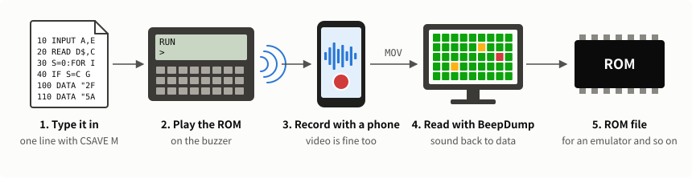
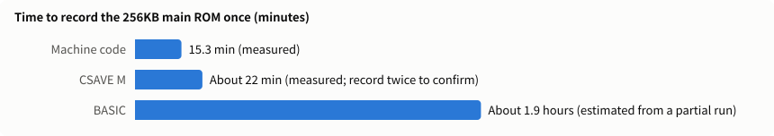
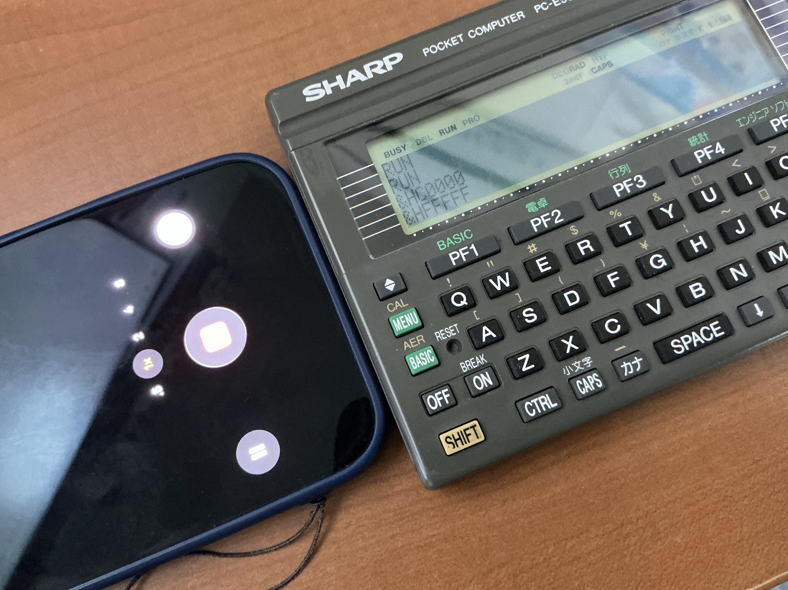
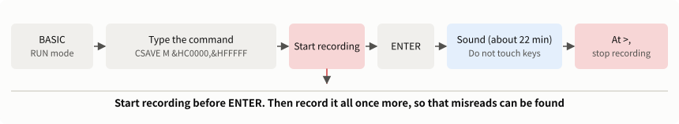
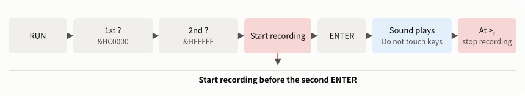
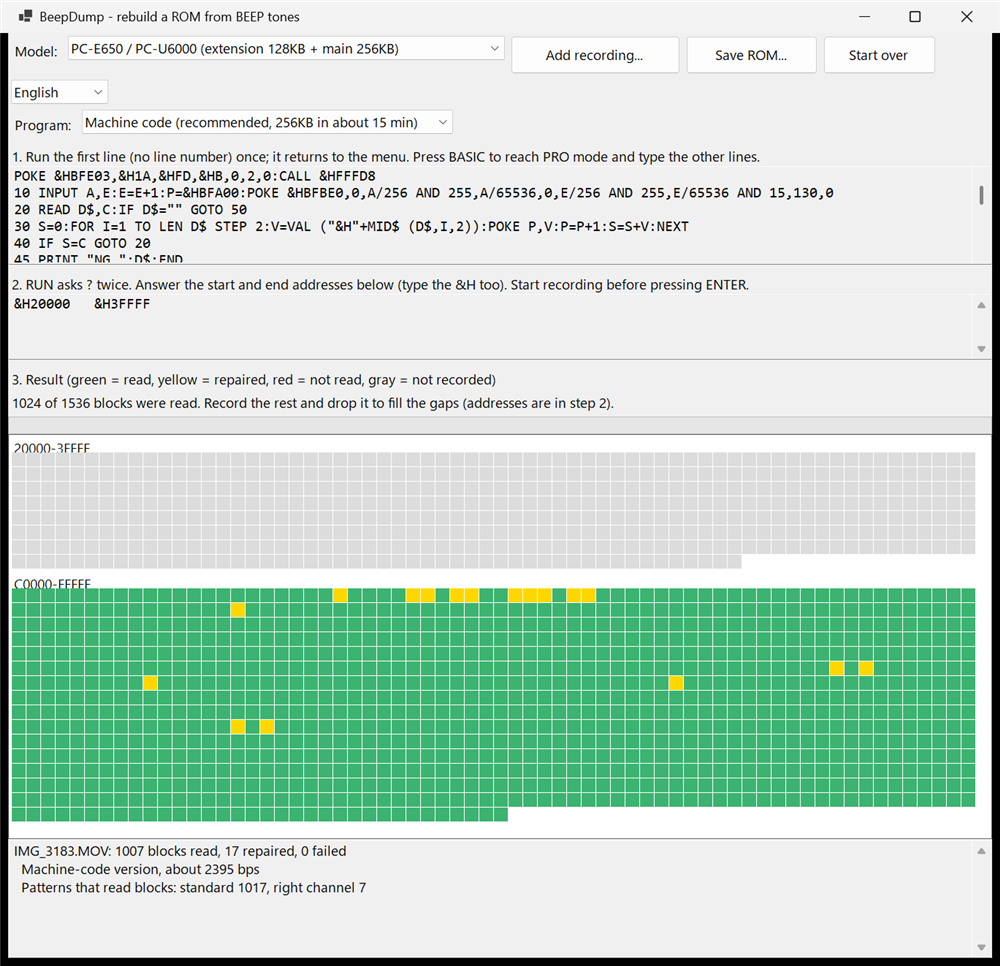
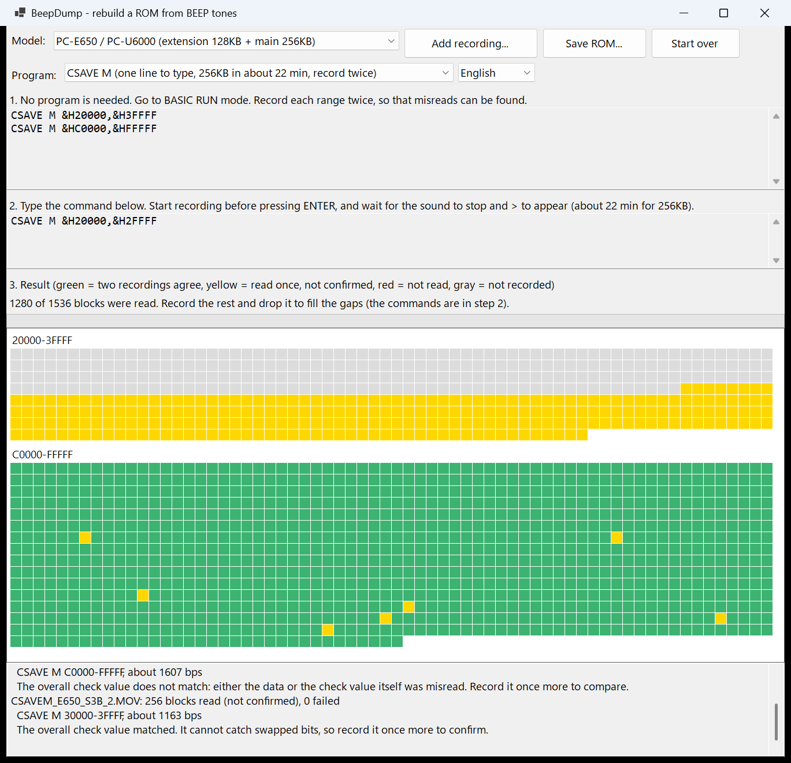
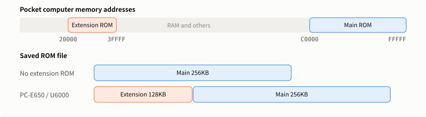
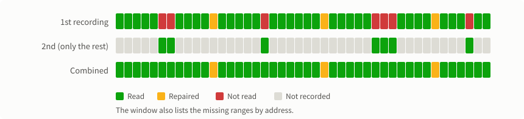
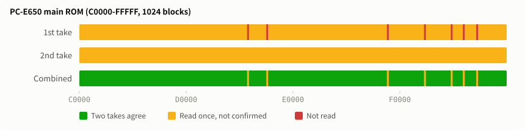

# PC-E500 BEEP ROMDump — Dump a ROM through its buzzer

[日本語](README.md)

ROMDump copies the built-in ROM of a Sharp PC-E500 series pocket computer to a PC with no peripherals. You type one command or a short program into the pocket computer, which plays the ROM through its buzzer. A phone records it, and a PC application turns the recording back into a ROM file.



## This is an experimental application

**This is an experimental application and has not been sufficiently verified.** Use it at your own risk. There is no guarantee that it works.

- **Very little has been tested on real hardware.** The machine-code version was run on one PC-E500 and one PC-U6000, reading one recording of each range. The results matched the ROM images at hand byte for byte (384KB on the PC-U6000). CSAVE M was read on one each of the PC-E500, PC-E550, PC-1480U, PC-E650, and PC-U6000, with no errors in the blocks read ([results](docs/TECHNICAL_en.md#real-hardware)). The BASIC version has only been run part of the way, on a PC-E500.
- **The only recording device tested is iPhone video.** Other devices have only been tried by processing a recording. The reading was also tuned on these few recordings.
- **Data that reads successfully is not guaranteed to be correct.** Only the check values can confirm it. With nothing to compare against, a remaining error would go unnoticed. During development, wrong data did pass the check on the BASIC version. That was addressed, but it cannot be said to be gone. For certainty, use the machine-code version, and record twice to confirm the two agree. CSAVE M has no check per block, so always record it twice.
- **Back up anything important first.** If a typing mistake slips through, the machine-code version can crash the machine and need a reset. It plays for a long time, so use fresh batteries.

If something does not work, or you confirm something new, please tell us in [Issues](https://github.com/litchi-gh/pc-e500_beep_romdumper/issues).

## Supported models

**This is only for the Sharp PC-E500 series of pocket computers,** the models below with an SC62015 (ESR-L) CPU. It does not work on other pocket computers, such as the PC-1350 or PC-G850.

| Model | ROM read | Saved file | On real hardware |
|---|---|---|---|
| PC-E500 | Main | 256KB | Machine code and CSAVE M in full, BASIC part of the way |
| PC-E500PJ | Main | 256KB | — |
| PC-1480U | Main | 256KB | CSAVE M in full |
| PC-1490UII | Main | 256KB | — |
| PC-E550 | Main | 256KB | CSAVE M in full |
| PC-E650 | Main + extension | 384KB | CSAVE M, main and `30000` to `3FFFF` |
| PC-U6000 | Main + extension | 384KB | Machine code and CSAVE M in full |

- **Checked on the emulator:** the machine-code and BASIC versions were run on all 7 of these models, and the resulting sound was read with BeepDump and compared with the ROM. All 8 blocks tried on the machine-code version matched, and the blocks read on the BASIC version had no errors (with 32KB and 64KB of RAM; 64KB only on the PC-E650 and PC-U6000). Only part of the end of each ROM was tried, and the emulator's timing differs from real hardware. For CSAVE M, the sound of the whole ROM on all 7 models was turned back into bits and matched the ROM.

## Which method to use

**CSAVE M is recommended if you want to avoid typing, and the machine-code version if you want it done quickly.** There are three methods, and the application detects which one it is hearing.

| | CSAVE M | Machine code | BASIC |
|---|---|---|---|
| Typing | **1 line**, 23 characters (no program) | 21 lines, about 900 characters | 2 lines, about 190 characters |
| Time for the 256KB main ROM | About 22 minutes (measured), twice | **15.3 minutes** (measured) | About 1.9 hours (estimated from a partial run) |
| Read from one recording (real hardware) | 99.3 to 100% (the second recording fills in the rest) | **Everything** (PC-E500, PC-U6000) | About 96% (record the rest again) |
| How the data is confirmed | **Comparing two recordings** (no check per block) | A check per block | A check per block (a sum, so weak) |
| If you mistype | No machine code runs, so it cannot crash | Usually `NG` on `RUN`. A mistake that slips through can crash the machine and need a reset | Stops with an error, or plays unreadable sound |



## What you need

- A PC-E500 series pocket computer ([Supported models](#supported-models))
- A phone that records audio or video (tested with iPhone video)
- A PC and the application ([System requirements](#system-requirements)). On Windows, `BeepDump.exe` from [Releases](https://github.com/litchi-gh/pc-e500_beep_romdumper/releases) runs on its own

See the [installation guide](docs/INSTALL_en.md) for how to get the application, and how to install ffmpeg, which Linux and Mac need.

## System requirements

### Application

| | Windowed application (`BeepDump.exe`) | Command-line version (`beepdump`) |
|---|---|---|
| OS | Windows 11 (64-bit) | Windows 11 (64-bit), Linux (x64, Arm64), macOS 15 or later (Intel, Apple Silicon) |
| Language | Japanese, English | English |
| .NET installation | Not needed | Not needed |
| Recordings it can read | MOV, MP4, M4A, WAV, and others that Windows Media Foundation can read | WAV on any OS. Others work directly on Windows and need `ffmpeg` on Linux and macOS |
| Tested on | Windows 11 Pro | Windows 11 Pro, Linux (Ubuntu 26.04 on WSL, x64) |

- **OS:** the OS list above comes from the [.NET 10 supported OS list](https://github.com/dotnet/core/blob/main/release-notes/10.0/supported-os.md). Linux needs glibc 2.27 or later, and there is no build for Alpine (musl).
- **Windows 10:** .NET 10 supports only the LTSC and Enterprise editions.
- **Windows N editions:** these lack Media Foundation, so reading MOV and similar formats needs the Media Feature Pack. WAV works as it is.
- **Memory:** about 2GB for a 15-minute recording and about 2.8GB for a 22-minute CSAVE M recording, and more for longer ones.
- **Analysis time:** on a Core i5-1235U (10 cores) with 16GB of memory, 15 to 30 seconds for a clean 15-minute machine-code recording and about 3 minutes for a hard one. A 22-minute CSAVE M recording also takes about 3 minutes. It uses all CPU cores.

### Pocket computer

See [Supported models](#supported-models). No peripherals are needed. It plays for a long time, so use fresh batteries.

### Recording device

A phone or anything else that can save one of the formats above. Tested with iPhone video (48 kHz, stereo).

## Steps

### 1. Enter the program

**CSAVE M needs no program.** Go to RUN mode in BASIC, and continue with [2. Record](#2-record).

The machine-code and BASIC versions need the programs below. There are also images of the listings wrapped to the machine's 40-column screen, which are easier to type from. Do not press ENTER at a wrap.

- Machine code: [BEEPFAST.png](BASIC/BEEPFAST.png)
- BASIC: [BEEPDUMP.png](BASIC/BEEPDUMP.png)

#### Machine-code version

1. Start BASIC and run this command as it is, with no line number. It reserves memory for the machine code and only needs to be run once. It returns you to the menu.

   <pre style="font-size:1.25em; white-space:pre-wrap"><code>POKE &amp;HBFE03,&amp;H1A,&amp;HFD,&amp;HB,0,2,0:CALL &amp;HFFFD8</code></pre>

2. Press the BASIC key to enter BASIC, and press it again for PRO mode.
3. Type in this listing.

<!-- list:BEEPFAST.TXT skip=1 -->

<pre style="font-size:1.25em; white-space:pre-wrap"><code>5 IF PEEK &amp;HBFD1B&gt;&amp;HFA THEN PRINT "POKE LINE FIRST":END
10 INPUT A,E:IF A&gt;E GOTO 45
15 E=E+256:P=&amp;HBFA00:POKE &amp;HBFBE0,0,A/256 AND 255,A/65536,0,E/256 AND 255,E/65536 AND 15,130,0
20 READ D$,C:IF D$="" GOTO 50
30 S=0:FOR I=1 TO LEN D$ STEP 2:V=VAL ("&amp;H"+MID$ (D$,I,2)):POKE P,V:P=P+1:S=S+V*I:NEXT
40 IF S=C GOTO 20
45 PRINT "NG ";D$:END
50 IF P&lt;&gt;&amp;HBFA96 GOTO 45
55 CALL &amp;HBFA00
100 DATA "2FB637D9E8FB0B000C00FA0BCC018008",22173
110 DATA "5A0464FA0456FA8CE0FB0B3065FF081A",29044
120 DATA "2708A50464FAFD544D66CC01000456FA",27021
130 DATA "B637B537CC010690270477FA7D011B09",18924
140 DATA "8DE3FB0B4D541B2D3071FD8FD100E8FB",36096
150 DATA "0B96273F9F079024455045650477FA7D",25920
160 DATA "011B0D063071FD8F750B401FEF08009F",22673
170 DATA "0477FA0477FA74CC00083069FD100490",24940
180 DATA "FAF41E043069FD100490FA7D001B1506",18729
190 DATA "8BE6FB0BEF06",4378
200 DATA "",0</code></pre>

<!-- /list -->

4. Press the BASIC key to return to RUN mode.

If you have a CE-140F (or something that replaces it), you can load the program in RUN mode instead of step 3. The file is [BASIC/BEEPFAST.BAS](BASIC/BEEPFAST.BAS).

<pre style="font-size:1.25em"><code>LOAD "X:BEEPFAST.BAS"</code></pre>

#### BASIC version

Enter BASIC, switch to PRO mode, type in this listing, and return to RUN mode. With a CE-140F or a replacement, you can load [BASIC/BEEPDUMP.BAS](BASIC/BEEPDUMP.BAS) in RUN mode instead of typing (`LOAD "X:BEEPDUMP.BAS"`).

<!-- list:BEEPDUMP.TXT skip=0 -->

<pre style="font-size:1.25em; white-space:pre-wrap"><code>10 INPUT A,E:A=INT (A/256)*256:FOR I=1 TO 99:NEXT
20 S=A/256 AND 255:BEEP 1,A/5000,8:FOR A=A TO A+255:BEEP 1,PEEK A,8:S=S+PEEK A:NEXT:BEEP 1,S-32768 AND 255,8:BEEP 1,S/257,8:IF A&lt;=E GOTO 20</code></pre>

<!-- /list -->

### 2. Record

Video works too. Only the audio is used, so the picture does not matter.

Put the phone near the buzzer, in a quiet room, and try not to move it. A fairly quiet recording is fine: a PC-U6000 recording at about 1/7 of the PC-E500's level was read completely.



#### CSAVE M



1. In RUN mode in BASIC, type one of these commands. **Start recording before you press ENTER.**

   | Range | Command | Time |
   |---|---|---|
   | Main ROM (all models) | `CSAVE M &HC0000,&HFFFFF` | About 22 min |
   | Extension ROM (PC-E650 / PC-U6000), the part with data | `CSAVE M &H30000,&H33FFF` | About 1.5 min (calculated) |
   | Whole extension ROM | `CSAVE M &H20000,&H3FFFF` | About 16 min |

2. Wait for the sound to finish. **Do not touch the keys while it plays.** A steady tone plays twice, for about 7 seconds in all, before the sound of the data starts.
3. When it finishes, `>` appears. Stop recording.
4. **Record the same thing once more.** CSAVE M has no check per block, so misreads only show up by comparing two recordings.

A partial recording can still be read (tested on synthetic sound).

#### Machine-code and BASIC versions



1. Type `RUN`. It asks `?` twice. Answer with these addresses, including the `&H`. **Start recording before you press ENTER the second time.**

   | Range | First `?` | Second `?` | Machine code | BASIC |
   |---|---|---|---|---|
   | Main ROM (all models) | `&HC0000` | `&HFFFFF` | 15 min | About 1.9 hours |
   | Extension ROM (PC-E650 / PC-U6000), the part with data | `&H30000` | `&H33FFF` | About 1 min | About 8 min |
   | Whole extension ROM | `&H20000` | `&H3FFFF` | About 8 min | About 1.7 hours |

2. Wait for the sound to finish. **Do not touch the keys while it plays.** The machine-code version takes a moment before the sound starts.
3. When it finishes, `>` appears. Stop recording.

To stop early, hold the ON key until the sound stops (about a second on the machine-code version). A partial recording can still be read.

For a first try, a short range such as `&HC0000` and `&HC0FFF` is a good idea (about 20 seconds on the machine-code version).

### 3. Turn the recording into a ROM

1. Start `BeepDump.exe` and choose the model at the top. Choosing a method under Program shows what to type and the steps. The selector to its right switches between Japanese and English.
2. Drop the recording (MOV / MP4 / M4A / WAV) on the window. The picture in a video is not used, so a black video is fine. Reading a CSAVE M recording switches Program to CSAVE M automatically.
3. When reading finishes, a grid shows the result for each block. This takes from tens of seconds to a few minutes. On the machine-code and BASIC versions, harder recordings take longer, because more analysis methods are tried.

   | Color | Machine code, BASIC | CSAVE M |
   |---|---|---|
   | Green | Read | Two recordings agree |
   | Yellow | Read after correcting a small misreading, or the address could not be confirmed (it passes the check) | Read, but only once, so not confirmed |
   | Red | Not read, or recordings disagree about its content | The same |
   | Gray | Not recorded yet | The same |

   

   This is the window after reading a real machine-code recording of the PC-U6000 main ROM. The extension ROM has not been recorded yet, so it is gray, and its addresses appear in step 2.

   Yellow cells pass the check, but are less certain than green. For certainty, record the ranges shown in step 2 once more. If the content is the same, they turn green (adding the same recording again, as a copy, or converted, does not confirm anything). See [ANALYSIS_en.md](docs/ANALYSIS_en.md#58-repairing-bits) for how repair works.

   

   This is the window after reading three real CSAVE M recordings of a PC-E650 (the main ROM twice, and `30000` to `3FFFF` of the extension once). In the main ROM, what both recordings read is green. The 7 blocks that were red the first time and the extension, recorded only once, are yellow.

4. When everything is there, press Save ROM.

On a PC-E650 or PC-U6000, record the main and extension ROMs separately and drop both. The saved file is 384KB (extension first, then main).



### 4. Record what is missing

If any cell is red or gray, step 2 in the window lists the addresses still missing.



1. Without closing the application, answer the `?` prompts with those addresses and record. The BASIC version may not read a short recording, so the range shown starts a little before what is missing and covers at least 8 blocks (2 KB). If you choose a range yourself, do the same.
2. Drop the recording. The missing blocks are filled in. If a neighboring block is read again and its content differs, it goes back to red (one more recording decides it).

You can also record everything again. If the noises fall in different places, two recordings make up for each other. If you closed the application, drop the earlier recording again too and you get the same result.

A block that differs between recordings turns red. Record it once more, and the content that agrees is used.

**On CSAVE M, recording everything again is recommended.** A full second recording both checks for misreads and fills the red cells. On a real PC-E650, this filled the 7 blocks that were red the first time. Commands for narrower ranges appear in step 2.



If you save with blocks missing, those blocks are filled with `FFh` (you are asked to confirm). This is what you do if you recorded only the part of the extension ROM with data. In the ROM images at hand, the rest is all `FFh`.

## Troubleshooting

| Symptom | What to check |
|---|---|
| Stops with `NG` and some DATA (machine code) | The DATA on the line shown has a typing mistake. Fix it and `RUN` again |
| Stops with only `NG` (machine code) | The addresses are reversed, or a DATA line is missing. Check the addresses and `LIST` |
| `POKE LINE FIRST` appears (machine code) | The memory for the machine code is not reserved. Run the `POKE` line, go back with BASIC on the menu, and `RUN`. The program you typed is kept |
| `Illegal function call in 15` (machine code) or `Data out of range in 20` (BASIC) after answering `?` | The address has too many digits. `&HFFFFF` has five Fs |
| `Data out of range` or a similar error after answering `?` | The program has a typing mistake. Compare it with `LIST` |
| The application says no tones were found, or could not read the recording | The recording is too quiet or has loud noise. Move the phone closer and record again |
| Many red cells (the BASIC version leaves a few per recording) | Record the missing part again and add it. Avoid noises and talking |
| Green, but you want to be sure | Record twice and drop both. Any disagreement turns red |
| "Could not read the CSAVE M header" | The start of the recording is cut off. Start recording before you press ENTER |
| "The overall check value does not match" (CSAVE M) | Either the data or the check value was misread. On one real recording all the data was correct and only the check value was misread. Record once more to compare |
| CSAVE M is all yellow | That is normal. Record once more, and what agrees turns green |

## Command-line version

`beepdump` has no window and comes in Windows, Linux, and Mac versions. Its messages are in English only. The Windows one is available from [Releases](https://github.com/litchi-gh/pc-e500_beep_romdumper/releases). The Linux and Mac ones need [building](docs/BUILD_en.md). Each runs on its own.

```text
beepdump decode -m e650 -o PC-U6000.rom IMG_3183.MOV IMG_3184.MOV
beepdump listing            # print the listing to type in (--basic for BASIC)
beepdump listing --csave -m e650    # print the CSAVE M commands
beepdump --help
```

- `-m e500` (the default) is the 256KB main ROM. `-m e650` is the 384KB of extension and main ROM.
- Give it any number of recordings, and they fill each other's gaps. Missing ranges are listed by address. To add a retake, give the earlier recordings too.
- An existing ROM file is not overwritten unless you add `--force`. If a recording could not be read, it is not overwritten even with `--force`.
- The exit code is 0 if everything was read, 1 if some is missing (the ROM is still written, with `FFh` there), and 2 on an error.
- WAV can be read on any OS. MOV and other formats work directly on Windows, and need [ffmpeg](docs/INSTALL_en.md#ffmpeg) on Linux and Mac.

It has been run on Windows and on Linux (Ubuntu on WSL, x64). If the Mac version will not start on Apple Silicon, try `codesign --sign - beepdump`.

## More detail

- [docs/INSTALL_en.md](docs/INSTALL_en.md) — installation, including ffmpeg
- [docs/BUILD_en.md](docs/BUILD_en.md) — building (the .NET SDK, making a release)
- [docs/ANALYSIS_en.md](docs/ANALYSIS_en.md) — the details of the analysis, from recording to ROM
- [docs/CHANGELOG_en.md](docs/CHANGELOG_en.md) — the change history
- [docs/TECHNICAL_en.md](docs/TECHNICAL_en.md) — the sound format, changing the speed, what has been verified, building, and the file layout

## License

The programs and documents are under the [MIT License](LICENSE). The rights to the ROM's content belong to Sharp and other rights holders. Keep any ROM you dump for use with your own machine, and do not publish or distribute it. This project is not affiliated with Sharp.
