# ROMDump の音声解析

[English](ANALYSIS_en.md)

> **実験的なアプリケーションです。** まだ十分に検証されていません。[README](../README.md#実験的なアプリケーションです) を先に読んでください。

録音から ROM のバイト列に戻すまでに、BeepDump が何をしているかを順に説明します。コードは [BeepDump/src/BeepDump.Core/](../BeepDump/src/BeepDump.Core/) にあり、この文書の数値はコードの定数と同じです。

使い方は [README.md](../README.md)、音の形式の一覧は [TECHNICAL.md](TECHNICAL.md) を見てください。

## 全体の流れ

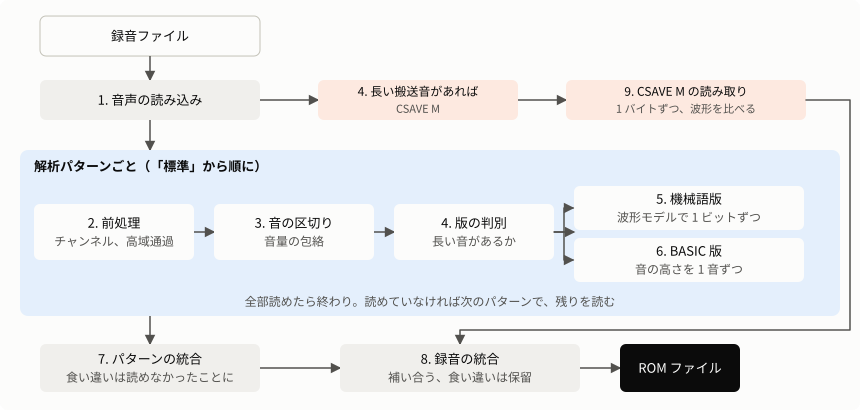

解析の土台にしている考え方は 3 つです。

- **検査値を最後の判定に使う。** 手がかりは録音によって当てになったりならなかったりするので、いろいろな読み方を試し、検査の通ったものだけを採ります。読み方を増やしても、検査が誤りを止めている限りデータの正しさは下がりません。
- **読めたものから学ぶ。** 機種や録音機材ごとの癖（ブザーの響き、BASIC の処理時間など）は決め打ちせず、正しいと分かったブロックから求めます。
- **読めなければ読めないと報告する。** 誤ったデータを ROM に入れるより、録り直しを求める方を選びます。

CSAVE M にはブロックごとの検査値がなく、1 つ目の考え方が使えません。別の録音との比較で確かめます（[9 章](#9-csave-m-の読み取り)）。

## 1. 音声の読み込み

[AudioFile.cs](../BeepDump/src/BeepDump.Core/AudioFile.cs)、[WavReader.cs](../BeepDump/src/BeepDump.Core/WavReader.cs)

| 形式 | 読み方 |
|---|---|
| WAV（8/16/24/32 bit の PCM、32 bit 浮動小数点） | 自前の読み込み。どの OS でも同じ結果 |
| そのほか（Windows） | Media Foundation で 16 bit PCM に変換 |
| そのほか（Linux、Mac） | `ffmpeg` で WAV に変換してパイプから読む |

サンプリング周波数は録音のまま使い、変換しません。ステレオの録音は左右を別々に持ちます。動画は音声だけを取り出します。

## 2. 前処理

[Analyzer.cs](../BeepDump/src/BeepDump.Core/Analyzer.cs) の `Prepare`

録音機材による違いを吸収するため、解析のしかたを 11 通り用意しています。

| # | パターン | チャンネル | 高域通過 | 音量のならし | 検出のしきい値 | 先読み |
|---|---|---|---|---|---|---|
| 1 | 標準 | 平均 | 800 Hz | なし | 0.12 | 3 ビット |
| 2 | 音量のならし | 平均 | 800 Hz | あり | 0.12 | 3 |
| 3 | 左チャンネル | 左 | 800 Hz | なし | 0.12 | 3 |
| 4 | 右チャンネル | 右 | 800 Hz | なし | 0.12 | 3 |
| 5 | 左右の差（逆相の録音） | (左 − 右) / 2 | 800 Hz | なし | 0.12 | 3 |
| 6 | 低い音も使う | 平均 | 300 Hz | なし | 0.12 | 3 |
| 7 | 高い音だけ使う（低い雑音が多い録音） | 平均 | 2000 Hz | なし | 0.12 | 3 |
| 8 | 小さい音も拾う | 平均 | 800 Hz | なし | 0.05 | 3 |
| 9 | 大きい音だけ拾う（響きが長い録音） | 平均 | 800 Hz | なし | 0.3 | 3 |
| 10 | 先読みを増やす | 平均 | 800 Hz | なし | 0.12 | 5 |
| 11 | 音量のならし + 先読みを増やす | 平均 | 800 Hz | あり | 0.12 | 5 |

モノラルの録音では、左右を使う 3 つのパターンを飛ばします。先読みは機械語版だけに効くので、BASIC 版では 10 と 11 を、読めたブロックがあれば飛ばします。

BASIC 版では、読めたブロックがあれば 5、6、7、8、9 も飛ばします。受け入れの判定を標準の音で調整してあり、音の中身や区切り方を変えると和の変わらない読み違いが判定をすり抜けるからです。実機の録音とその加工で、これらのパターンで誤ったデータが通りました。

- **高域通過:** 4 次の Butterworth フィルタです。低い雑音（空調、机の振動など）を落とします。
- **音量のならし:** 0.2 秒ごとの音量（実効値）の逆数を掛け、録音機材の自動音量調整などによるゆっくりした変化をならします。無音まで持ち上げないよう、いちばん大きい区間の 2% より小さい区間はそれ以上持ち上げません。

## 3. 音の区切りを見つける

[Tones.cs](../BeepDump/src/BeepDump.Core/Tones.cs) の `Segmenter`

音の高さは見ず、音量だけで「鳴っている区間」を探します。

1. 約 1/12000 秒ごとに、前後 0.4 ms の実効値（音量の包絡）を求めます。
2. 「周囲の音量」を求めます。包絡の 0.1 秒間の最大値を、さらに 0.05 秒で平均したものです。
3. 包絡がしきい値を超える所を「鳴っている」とします。しきい値は次の大きい方です。
   - 周囲の音量 × 検出のしきい値（標準は 0.12）
   - 録音全体の包絡の下位 0.2% の値の 4 倍（無音の雑音より上にするため）
4. 短いすき間（BASIC 版は 4.5 ms、機械語版は 3.5 ms 未満）はつなぎます。BASIC 版は 2.4 ms 以下の短い音を捨てます。

## 4. どの方式の音かを判別する

`TapeDecoder.Looks`、`FastDecoder.LooksFast`

最初に CSAVE M かどうかを調べます。同じ周期の繰り返しが 1.5 秒以上続く所（搬送音）を探し、10000 周期と 11000 周期に近い組（0.75〜1.15 倍）があれば CSAVE M です。解析パターンは使わず、[9 章](#9-csave-m-の読み取り)の読み取りだけを使います。00h の並びも短い周期が続きますが、開始ビットで周期が乱れるので、繰り返しの強さで区別できます（実機の録音で搬送音は 0.95 以上、00h の並びは 0.61 以下。しきい値は 0.75）。

それ以外のときは、機械語版か BASIC 版かを見分けます。0.15 秒より長い音の塊が 2 つ以上あれば機械語版です。BASIC 版の 1 音はこれより十分短いので、見分けがつきます。

このとき、音の塊の中で典型的な音量（中央値）の 1/4 より小さいものは除きます。録音の前後の部屋の雑音も「長い音」に見えることがあり、学習用の並びと取り違えるからです。

## 5. 機械語版の読み取り

[FastDecoder.cs](../BeepDump/src/BeepDump.Core/FastDecoder.cs)

### 何が難しいか

機械語版は約 2400 bps で、1 ビットは 48 kHz の録音で約 20 サンプルしかありません。ブザーは出力を切り替えるたびに「カン」と鳴り、その響きが次のビットに重なります。響きの長さは機種で大きく違い、PC-E500 は 1 ms 程度ですが、筐体の違う PC-U6000 は 6 ms（約 15 ビット分）でもはっきり残ります。

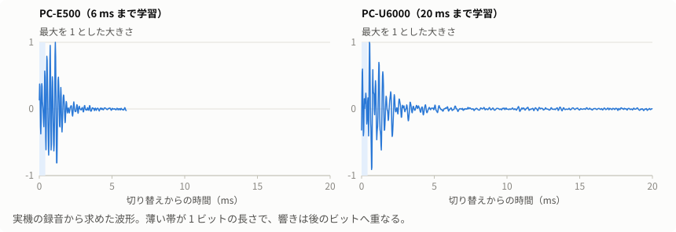

そこで、音を波形のモデルで説明する方法を使います。

```text
録音の波形 = 音量 × Σ 応答(時刻 − 切り替えの時刻 k) + 雑音
```

応答は、切り替え 1 回で出る波形です。立ち上がりと立ち下がりで形が違うので、別々に持ちます。データが決まれば切り替えの時刻が決まり、波形全体を計算できます。

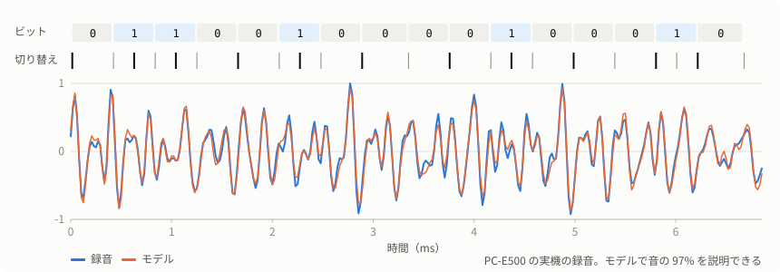

符号はバイフェーズです。各ビットの頭で必ず切り替え、1 のビットでは中央でも切り替えます。切り替えの時刻は次の 4 つの値で決まります（単位はサンプル）。

| 値 | 意味 |
|---|---|
| T | 0 のビットの長さ |
| M | ビットの頭から中央の切り替えまで |
| E | 1 のビットが 0 のビットより長い分（4 サイクル） |
| G | データのバイトの切れ目で余分にかかる時間（36 サイクル） |

ほかの切れ目の時間は、機械語のサイクル数の比で G から求めます（同期の前後は 12、7、48、データから検査値は 42、検査値の中は 22 サイクル）。

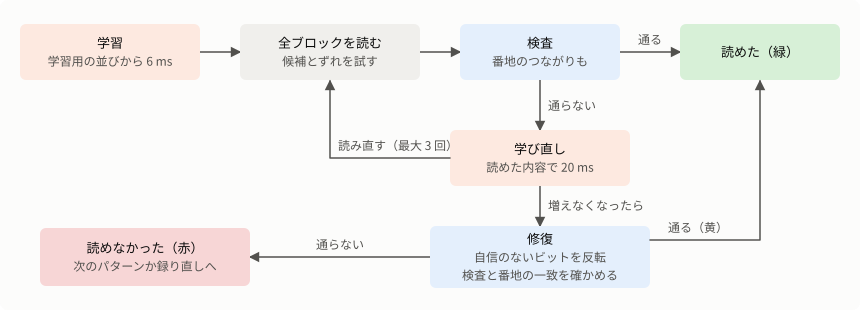

### 5.1 学習用の並びから学ぶ

録音の最初に、内容の分かっている音が流れます。`$00 $00 $5A` と機械語自身の先頭 128 バイトです。ここからビットの時間と応答を求めます。

1. **ビットの長さの見当:** 先頭の `$00` は周期的な音なので、自己相関の山から周期を求めます。
2. **少しずつ広げて当てはめる:** ビットの時間のわずかな誤差は、長い範囲で当てはめるほど積もって手がかりがなくなります。そこで先頭の 3 バイトから始め、4、5、6、8、10…と範囲を広げながら、次の 2 つを交互に繰り返します。
   - **応答を求める:** 切り替えの時刻を固定すると、波形は応答に対して一次式なので、最小二乗法で解けます（共役勾配法）。
   - **時間を求める:** 応答を固定し、残った音を波形の傾きで説明するように開始位置・T・M・G・E を同時に更新します（ガウス・ニュートン法）。1 回の更新で切り替えを 1 サンプル以上動かさないようにしています。
3. **前の版の機械語の判別:** 機械語を修正する前の録音も読めるように、前の版の並びでも当てはめ、よく合う方を採ります。

この段階の応答は 6 ms 分です。学習用の並びは 0.44 秒しかなく、長い応答を求めると当てはめが破綻します。実機の録音で 20 ms を試したところ、1 ブロックも読めなくなりました。

### 5.2 ブロックを切り出す

ブロックの間には約 10 ms の無音があり、ふつうはここで切れます。ところが響きの長い機種や物音があると無音が埋まり、いくつものブロックが 1 つの塊に見えます（PC-U6000 の実機では 2〜6 ブロックのつながりが多数出ました）。

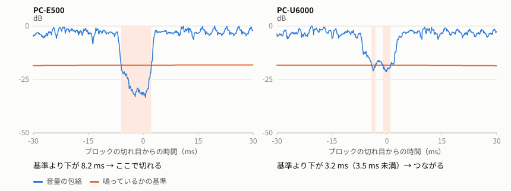

ブロックの長さはデータで少し変わりますが、T・E・G から範囲が分かります。長すぎる塊は、その範囲の前後で音がいちばん小さい 2 ms の終わりを、次のブロックの始まりとして切ります。学習用の並びと最初のブロックがつながったときも、ブロックの長さとバイト数の比から位置を求めて同じように切ります。

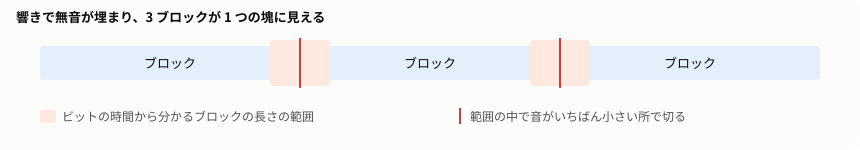

### 5.3 開始位置の候補を求める

ブロックの先頭は分かっている 3 バイト（`$00 $00 $A5`）です。これをいろいろな位置に置いてみて、録音をどれだけ説明できるかを調べます（0.5 サンプル刻み、−3 ms 〜 +7 ms）。

ただし、`$00` は周期的な音なので、合う位置がビット 2 つ分（約 40 サンプル）ごとに現れ、いちばん合う位置が本当の開始とは限りません。PC-U6000 の録音では、読めなかったブロックの 95% がこの取り違えでした。そこで合う位置の上位 5 つを候補として残します。そこでの音量も候補ごとに求めます。

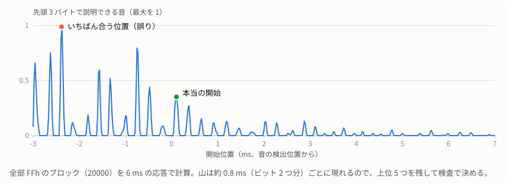

### 5.4 1 ビットずつ決める

候補の開始位置から、次を繰り返します（判定帰還と先読み）。

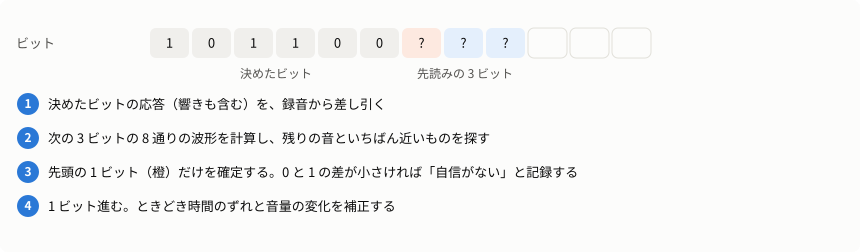

0 と 1 それぞれの最小の差を記録しておきます。この差が小さいビットは「自信がない」ビットで、後の修復で使います。

読み進めながら、次の 2 つを補正します（最初の 4 バイトは毎バイト、以降は 4 バイトごと）。

- **時間のずれ:** 残った音のうち波形の傾きで説明できる分から求めます。ポケコンの時計と録音機材の時計は少しずれているので、これで追います。
- **音量の変化:** 残った音のうち波形そのもので説明できる分から求めます。録音機材の自動音量調整で 1 ブロックの途中でも音量が変わることがあるので、これで追います。これがないと、周期 3 秒で 4 倍変わる音量の試験で 1 ブロックも読めませんでした。

### 5.5 検査

[TECHNICAL.md](TECHNICAL.md) にある S1 と S2 で調べます。

- 番地 = S1 − データの和。下位 8 bit が 0 でなければ失敗
- S1、S2 の最上位バイトが 15 を超えれば失敗（20 bit なので）
- データと番地から計算した累積和が S2 と違えば失敗
- 同期の `$A5` は位置合わせに使っていて、読んだ値は検査しません

検査に通らなければ、残りの開始位置の候補と、同期とデータの間の時間のずれ（±0.5、±1、±1.5 サンプル）を組み合わせて読み直し、検査の通るものを採ります。

### 5.6 読めたブロックから学び直す

読めたブロックは正しいデータが分かるので、学習の材料になります。応答を 20 ms に伸ばし、最大 16 ブロックと学習用の並びを使って応答とビットの時間を求め直します（応答 → 時間の順に 3 回）。そのあと読めなかったブロックを読み直し、増えなくなるまで最大 3 回繰り返します。

材料には、値の種類が多いブロックを選びます。全部 `FFh` のような周期的な音だけでは応答が決まらず、かえって読めなくなるからです（PC-U6000 の拡張 ROM はほとんど `FFh` で、実際に起きました）。

### 5.7 番地の確認

S2 は番地の 256 倍を足す形なので、番地の上位 8 bit を見ていません。S1 の上位のビットを読み違えると、データは正しいまま番地だけ違うブロックとして検査を通ります。実機の録音でも、`2xxxx` のブロックが `60000` や `90000` として通りました。

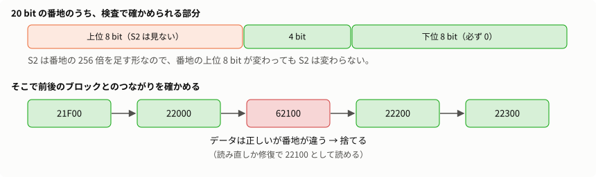

ブロックは番地の順に流れるので、前後それぞれ 4 つの読めたブロックと比べ、番地がつながるものよりつながらないものが多ければ捨てます。

全部 `00h` のデータでは S2 が 0 になるので、音を読めていなくても S1 の上位が立つだけで検査が通ることがあります。そこで全部 `00h` と読めたブロックは、音の半分以上を説明できているときだけ採ります。

### 5.8 ビットの修復

ここまでで読めないブロックは、1〜2 ビットの誤りが多いです。誤りを 1 つ正せば、そこから先は正しく読み進められます。

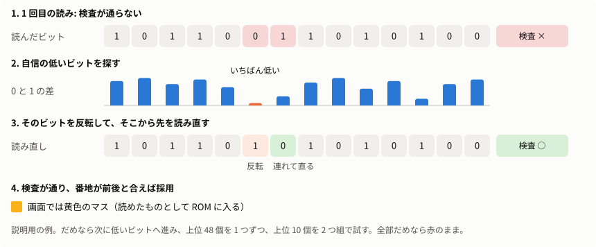

1. 開始位置の候補と時間のずれの組み合わせで読み、説明できなかった音がいちばん小さいものを基準にします。
2. 自信の低いビットの上位 48 個を、1 つずつ反転して読み直します。
3. だめなら上位 10 個の中から 2 つを反転します（45 通り）。
4. **検査が通り、かつ番地が前後から求めた番地と一致**すれば採ります。

試すのは最大 93 通りです。検査は 28 bit 以上あるので（番地の下位 8 bit と S2 の 20 bit）、番地の一致も含めて、偶然通る確率は無視できます。画面では黄色のマスになります。

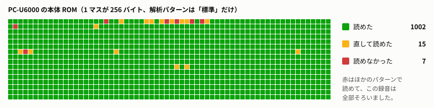

読めないブロックが全体の 1/4 より多いときは、修復しません。録音そのものに問題があるので、時間をかける意味が薄いからです。

## 6. BASIC 版の読み取り

[Decoder.cs](../BeepDump/src/BeepDump.Core/Decoder.cs)

### 何が難しいか

BASIC 版は `BEEP` の音の高さで値を送ります。周期は `倍率 × (90 + 4 × 値) / 256000` 秒で、1 音は 8 周期です。

- **短い音の周期が読みにくい。** 値 0 の音は 8 周期でも約 3 ms しかなく、倍音が少ないので、周期の 2 倍や 2/3 に読み違えやすくなります。
- **倍率が機械ごとに違う。** 校正用の音は鳴らさないので、録音から求めます。
- **検査が弱い。** 検査値は和なので、読み違いが打ち消し合うと通ります。

### 6.1 1 音の周期を読む

`PeriodReader` は倍音の並びで周期を求めます。

1. 音の区間をフーリエ変換します（16 倍以上にゼロを詰めて細かく見ます）。
2. 候補の周期 u について、基本周波数 `f0 = 256000 / u` の倍音の位置の強さの和から、倍音の間の位置の強さの和を引きます（16 kHz かサンプリング周波数の 0.45 倍の低い方まで）。
3. 候補を 0.5 刻みで調べ、いちばん大きい所を放物線で補間して頂上を求めます。

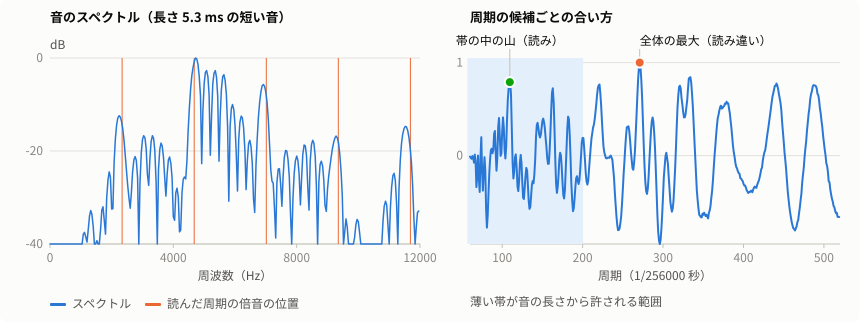

### 6.2 段階を踏んで絞り込む

| 順 | すること | 使う手がかり |
|---|---|---|
| 1 | 全部の音を読む | 音の長さから周期の範囲を絞る |
| 2 | ブロックに分ける | 間隔が長く、実際のすき間も長い所が境界。割れたブロックは 259 音になるようにつなぎ、見落とした境界は 259 音ずつに分ける |
| 3 | 読み直す | 次の音までの間隔から周期の範囲を絞る。処理時間はブロック内の役割（番地、データ、検査値）ごとに求める |
| 4 | 倍率を求める | 下記 |
| 5 | 番地を決める | 下記 |
| 6 | 倍率と癖を学ぶ | 検査の通ったブロックから |
| 7 | 通らなかったブロックを読み直す | 学んだ癖で（最大 3 回） |

**手順 3 の工夫:** 処理時間は時々揺れるので、倍音の多い長い音は広め（±3 ms）に探し、短い音だけ狭く（±1.2 ms）絞ります。

### 6.3 倍率を求める

周期が `倍率 × (90 + 4 × 値)` の格子に乗ることを使います。

1. 倍率の候補を 0.70〜1.10 の範囲で 0.00002 刻みに調べ、周期が格子によく乗る候補を集めます。
2. 候補ごとに先頭の 40 ブロックを読み、検査の通る数と、次のブロックと番地がつながる数を数えます。
3. 同数なら、値ごとの周期の片寄りが小さい候補を選びます。全部 `FFh` のような範囲では、全部の音が 1 段ずれても検査が通るからです。
4. 前の録音で倍率が分かっていれば、その ±0.002 の候補だけを見ます。短い録り直しでも倍率を間違えません。

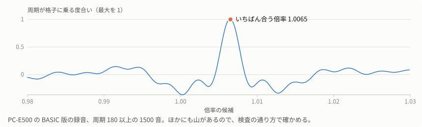

倍率は録音中にも少し変わるので（温度など）、ブロックごとに追い、検査の通ったブロックの中央値で前後 8 ブロックずつならします。

### 6.4 番地を決める

BASIC 版の番地は検査値と「番地 ÷ 5000」から逆算します。音を 1 つ読み違えただけで番地もずれ、検査も通ることがあります。値 6 を 1 と読むと和が 5 減り、5 ブロック先の番地になります。

そこで前後 16 ブロックの多数決で決めます。音の数からブロックの位置を数えるので、2 ブロックがつながっていても数え違えません。

ただし、支持する票が 2 票未満か、反対の票の 2 倍以下なら、番地を確かめられなかったとして「読めなかった」にします。短い録音では読み違いの向きがそろい、ずれた番地が 2 対 1 で勝つことがあるからです。このため短い録り直しは読めないことがあり、アプリは足りない範囲の 2 ブロック前から、合わせて 8 ブロック以上の範囲を案内します。

### 6.5 癖を学ぶ

検査の通ったブロックから、値ごとに次を覚えます。出てこない値は、近い値から補います。

| 覚えるもの | 理由 |
|---|---|
| 読みの片寄り | 値によって周期の読みが少しずれる |
| 処理時間（間隔 − 8 周期） | BASIC の処理時間は値で変わる。PC-E500 の値 13 は他より約 0.9 ms 短い |
| 音の長さ − 8 周期 | 響きの分 |

通らなかったブロックの短い音（周期 250 未満）は、値ごとに「倍音への合い方」を「予想される間隔と音の長さとのずれ」で減点して比べ、どの山かを選びます。値はその山の頂上から決めます。

キーを押している間は間隔が約 2.7 ms 伸びるので、これも正常なずれとして扱います。

### 6.6 受け入れの判定

BASIC 版は検査が弱いので、検査のほかに次も確かめます（`Plausible`）。

- ブロック全体で読みが格子から片寄っていない（中央値で 0.2 段未満）。全部の音が 1 段ずれると検査値も一緒にずれて通るので、これで防ぎます。
- 短い音（値 46 未満）の値と、音の長さのずれが 1.3 ms 以内。
- 短い音の値と、次の音までの間隔のずれが 1.1 ms 以内。キーを押している分の 2.7 ms 伸びは許します。

この 3 つの値は、実機の録音で調整しました。

### 6.7 修復

通らなかったブロックは、次の順に試します。

1. 音の長さから範囲を絞って短い音を読み直します。間隔はキーを押している間や実行の最初に伸びますが、音の長さは変わらないからです。
2. 読みの怪しい上位 10 音を 1 つずつ 2 番目の候補に入れ替え、検査の通る入れ替えがただ 1 つのときだけ採ります。

2 音以上の入れ替えは試しません。実機の録音で、偶然検査の通る誤った組み合わせを受け入れたからです。

## 7. パターンの結果を統合する

[Analyzer.cs](../BeepDump/src/BeepDump.Core/Analyzer.cs) の `Analyze`

- パターンを順に試し、ブロックが切れ目なく並んで読めなかったものがなければ止めます。
- パターンの間で内容が違うブロックは「読めなかった」にします。パターンは同じ音声を読むので、数が多くても確認にならないからです。
- 機械語版の 2 つ目以降のパターンでは、まだ読めていないブロックだけを読みます。番地はブロックの順番から分かります。学習の材料として、録音全体から 32 ブロックほどは読みます。
- 機械語版の 2 つ目以降のパターンでは、最初に読めた音の範囲（前後 0.05 秒を含む）だけを見ます。音量をならすと録音の前後の部屋の雑音が音の塊に見えます。雑音から学ぶと 1 ブロックも読めず、学び直して全部のブロックを読み直すことを繰り返します（実機の録音で、このパターンだけで 13 分）。雑音に番地を振ると、存在しないブロックが読めなかったものとして残り、全部読めても次のパターンに進みます。この範囲の外の実行を最初のパターンが 1 つも読めなかったときは、そこは読みません。足りない範囲として表示します。
- BASIC 版は全部の音から時間を学ぶので、毎回全部読みます。読めたブロックがあれば、使うのはチャンネルと音量のならしを変えるパターン（2、3、4）だけです。標準以外のパターン（5〜9）でしか読めなかったブロックは、検査が通っても緑にしません。
- 3 パターン続けて読めるものが増えなければ打ち切ります。物音で潰れた所は、ほかのパターンでも読めないからです。ただし 1 つも読めていない間は、全パターンを試します。

## 8. 録音の結果を統合する

[RomImage.cs](../BeepDump/src/BeepDump.Core/RomImage.cs)

| 状況 | 扱い |
|---|---|
| 初めて読めたブロック | そのまま採る |
| 前と同じ内容 | 別の録音で一致したので緑にする。修復したものや、番地を確かめられなかったものも同じ |
| 違う内容 | 緑でも黄でも、両方を保留して赤にする |
| 保留中のブロックを読んだ | 新しい内容が 2 回以上そろい、ほかのどの内容より多くなれば採って緑にする。同数なら保留のまま |

同じ録音は 1 回だけ数えます。ファイルの内容で比べるので、名前を変えたコピーも同じ録音と分かります。音声を変換したものは見分けられないので、確認には使えません。

## 9. CSAVE M の読み取り

[TapeDecoder.cs](../BeepDump/src/BeepDump.Core/TapeDecoder.cs)

音の形式は [TECHNICAL.md](TECHNICAL.md#csave-m-の音の形式) にあります。

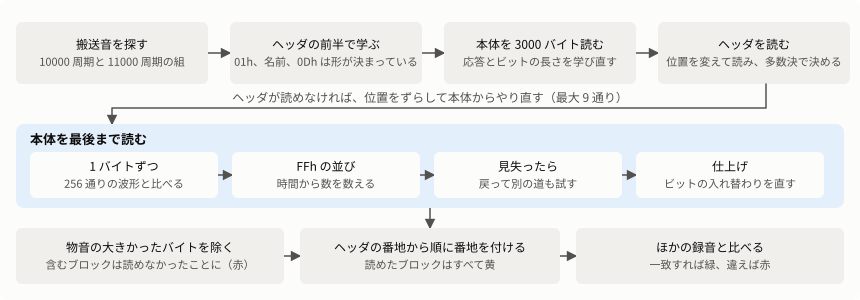

### 何が難しいか

- **検査で確かめられない。** 検査値はデータ全体の 1 のビットの数だけです。隣り合うビットが入れ替わると、数も時間も変わりません。機械語版のように「検査の通る読み方を探す」ことができないので、音との一致だけで読みます。
- **番地も区切りもない。** 1 バイトの時間は中身で決まります。数え違えると、そこから後ろの番地がすべてずれます。
- **響きが次のビットに重なる。** 筐体の響きは 10 ms ほど残り、ビットの長さ（0.33〜0.82 ms）よりずっと長く続きます。
- **同じ値の並びは手がかりが少ない。** FFh の並びは長い周期が続くだけで、バイトの切れ目はわずかな隙間でしか分かりません。

このため、**読めたブロックは 1 回の録音ではすべて黄色**にします。全体の検査値が合っても同じです。別の録音と一致して初めて緑になります（[8 章](#8-録音の結果を統合する)）。

### 9.1 最初の学習

1. 搬送音の半周期を、50 周期分の間隔で正確に測ります。ビットの長さの初期値は、この半周期から実機の録音で測った比で決めます（長い周期 2.4528 倍、短い周期 0.98183 倍、バイトの隙間 0.3377 倍）。
2. ヘッダの区間の始まりの並びに合わせて位置を決め、ヘッダの前半を読まずに仮定して応答を学びます。形は `01h`、名前（空白 16 個）、`0Dh` です。名前があっても多くは空白なので、読み始めるきっかけには足ります。名前を読んだら、読んだ値で学び直します。

応答は、ブザーの立ち上がりと立ち下がりの波形を別々に、チャンネルごとに最小二乗で求めたものです。音はこれらの重ね合わせとして扱います。

### 9.2 本体で学び直す

本体を、FFh 以外で 3000 バイト分読んで、ビットの長さと応答を求め直します。読み違いで時刻がずれたまま学ぶと応答がそのずれを吸収するので、応答の立ち上がりを先頭にそろえます。

位置が半周期ずれたまま読むと、立ち上がりと立ち下がりが入れ替わった応答ができて、つじつまだけが合います。**ヘッダは中身を確かめられるので、ヘッダで判定します。** 読めなければ、位置を搬送音の周期で 0、±0.5、±1、±1.5、±2 ずらして、本体からやり直します。

### 9.3 ヘッダを読む

学んだ応答で、開始位置を 1 サンプルずつ変えながら（48 kHz で ±120 サンプル）ヘッダを読みます。

- 決まった欄（17 番目の `0Dh`、24〜28 番目と 32〜48 番目の 0）がそろった読みだけを使います。0 の欄は 1 バイトまでの違いを許します。
- 開始番地と長さがメモリの中に収まらない読みも使いません。半周期ずれていると、決まった欄が偶然そろうことがあるからです。使える読みがなければ、9.2 のやり直しに進みます。
- 開始番地と長さは多数決で決めます。ヘッダの検査値まで合う読みは 3 票に数えます。
- 最初のバイトは直前の音の響きで読み違えやすいので、`01h` に固定します。

### 9.4 1 バイトずつ読む

バイトの 256 通りの値について、応答から波形を作って録音と比べ、残りの音がいちばん小さい値を採ります。読んだバイトの音は録音から引くので、次のバイトには響きが残りません。

- 応答は速さのために 3 ms に切ります。サンプルの間の時刻は 8 通りの位相で扱います。
- チャンネルは両方使い、雑音の大きさで重みを付けます。
- 読むごとに時刻のずれを測って追います。
- 1000 バイトごとに応答を学び直します。形が前と大きく違うとき（類似度 0.9 未満）は使いません。同じ値が続く所や読み違えた所から学ぶと、応答が壊れるからです。

### 9.5 見失ったとき

残りの音が大きいバイト（残りの割合が 0.8 と典型値の 1.6 倍の大きい方を超える）が 3 つ続いたら、読み違えて時刻がずれたとみなします。20 バイト戻り、候補の並びを 64 本まで並行して 30 バイト先まで伸ばします。

1 バイトの時間は 1 のビットの数だけで決まります。「何バイト読んで、1 が何個あったか」が同じ並びは同じ時刻にいるので、同じ時刻の中で最も合うものだけを残します（ビタビ法）。時刻の違う並びを無理に比べずに済み、時刻の誤った並びは後の音と合わなくなって落ちます。残りの音が 0.97 倍以下に減らなければ、元の読みに戻します。

実機の録音では、乱れの前後の時間は正解と 1 サンプルも違いませんでした。数え違いはほとんどなく、失うのは乱れの中の値だけです。

### 9.6 FFh の並び

拡張 ROM の大半は FFh です。FFh の 1 バイトの時間は一定なので、音を読むより時間から数える方が確かです。

- FFh が 32 バイト続いたら、読み方を切り替えます。物音で音が合わなくても、同じ周期のまま先で FFh に合うなら、そこまでのバイト数を時間から決めます。
- 読み終わったあとも、FFh に挟まれた FFh 以外のかたまりを調べます。時間が FFh の整数倍（誤差 0.02 以内）で、音も FFh でおおむね説明がつくなら、物音とみなして FFh に置き換えます。本物のデータなら時間が整数倍にならないか、形が合いません。
- データが FFh で始まるときは、区切りがセル単位でずれてもほとんど同じ音になり、次のデータを読み違えます。64 バイト分の音で比べて、区切りを決めます。

### 9.7 仕上げ

全部読んだあとで、音の区間ごと（8000 バイトごと）に 10 ms の長い応答を学び直して、総点検します。短い応答では区別しにくいビットの入れ替わりも、長い応答では差が開きます（実機の録音で 10 倍以上）。

- 隣り合うビットの入れ替えを試し、残りの音が減れば直します。バイトの切れ目をまたぐ入れ替わりも試します。
- 残りの音が特に大きいバイト（普段の 1.3 倍超）は、1 の数が同じ値をすべて試します。

### 9.8 物音の入ったバイトを除く

残りの音が普段の雑音の 10 倍を超え、しかも音そのものの 25% を超えるバイトは信用せず、そのブロックを赤にします。**実機の録音で、物音の中では誤読の方が正解より音に合っていました。** 音に情報が残っていないので、読み方の工夫では直せません。録り直して補います。

### 9.9 番地を付ける

番地はヘッダの開始番地から数えます。乱れでバイト数がずれたときは、その後ろを末尾から数え直します。読めたバイト数がヘッダの長さと合わず、番地を決められないブロックは、読めなかったことにします。256 バイトに満たない端のバイトは使いません。

全体の検査値は、合っても合わなくてもブロックの色を変えず、メッセージで知らせるだけです。

- 合っても、ビットの入れ替わりは分かりません。
- 検査値そのものを読み違えることがあります。データが全バイト正しい実機の録音で、検査値だけ読み違えた例がありました（`C346` を `C941`）。正しい値でも読んだ値と同じくらい音に合うとき（残りの音が 1.03 倍以内）は、合ったものとして扱います。この例は 1.033 倍で、判定から外れました。

### 試して効かなかったこと

強調フィルタ、帯域通過、線形予測による白色化、高域だけのチャンネル、読み取り中の長い応答、前後の値ごとの応答、3 次補間は、実機の録音で結果が悪くなるか、ほとんど変わりませんでした。

## 誤りを防ぐ仕組みのまとめ

| 起こりうる誤り | 防ぐ仕組み | 版 |
|---|---|---|
| ビットの読み違い | S1 と S2 の検査 | 機械語 |
| 開始位置の取り違え | 検査の通る候補を採る | 機械語 |
| 番地の上位の読み違い | 前後のブロックとのつながり | 機械語 |
| 音のない所を全部 0 と読む | 音を説明できているかを確かめる | 機械語 |
| 修復で偶然検査が通る | 反転は 2 ビットまで、番地の一致も条件にする | 機械語 |
| 番地のずれ | 前後 16 ブロックの多数決。票が足りなければ読めなかったことにする | BASIC |
| 全部の音が 1 段ずれる | 倍率の選び方、格子からの片寄りの確認 | BASIC |
| 読み違いの打ち消し合い | 音の長さ、間隔との矛盾の確認 | BASIC |
| 修復で偶然検査が通る | 1 音だけ、候補がただ 1 つのときだけ | BASIC |
| パターンや録音による食い違い | パターンの間なら読めなかったことにする。録音の間なら保留し、新しい内容が最多になったら採る | 機械語、BASIC |
| 確かめられないデータを信用する | 1 回の録音では緑にしない | CSAVE M |
| 半周期ずれて読む | ヘッダの決まった欄で確かめ、位置を変えてやり直す | CSAVE M |
| 物音の中の読み違い | 残りの音の大きいバイトを含むブロックを読めなかったことにする | CSAVE M |
| 数え違いで番地がずれる | 時刻と 1 の数で並びを比べる。バイト数がヘッダと合わなければ読めなかったことにする | CSAVE M |
| 録音による食い違い | 保留し、新しい内容が最多になったら採る | CSAVE M |

**それでも残る弱点:** BASIC 版の検査は和なので、上の仕組みをすり抜ける読み違いがないとは言えません。確実を期すなら、機械語版か 2 回の録音を使ってください。機械語版でも、検査と番地のつながりを同時にすり抜ける誤りの可能性はゼロではありませんが、これまで実機の録音では起きていません。CSAVE M は 1 回の録音では確かめる手段がありません。2 回の録音で同じ所を同じように読み違えると、緑のまま誤りが残ります。

## 実機の録音で各段階が効いた量

開発中に PC-U6000 の録音で測った値です。それぞれ前の行の処理に足していったときの、読めたブロックの数です。

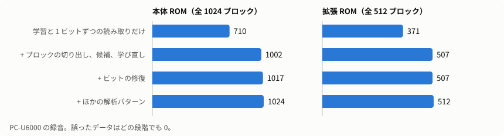

| 処理 | 本体（全 1024 ブロック） | 拡張（全 512 ブロック） |
|---|---|---|
| 学習用の並びの学習と 1 ビットずつの読み取りだけ | 710 | 371 |
| ブロックの切り出し、開始位置の候補、学び直し | 1002 | 507 |
| ビットの修復 | 1017 | 507 |
| ほかの解析パターン | 1024 | 512 |

どちらも誤ったデータは 0 で、2 本を合わせた 384KB は手元の ROM イメージと全バイト一致しました。

## 録音機材の違いへの強さ

いろいろな機材で録ったときを試すため、PC-E500 の実機の録音を加工して読みました。本物の別の機材で録ったものではありません。

### 機械語版

15 分の録音のうち 99 ブロック分を使いました。

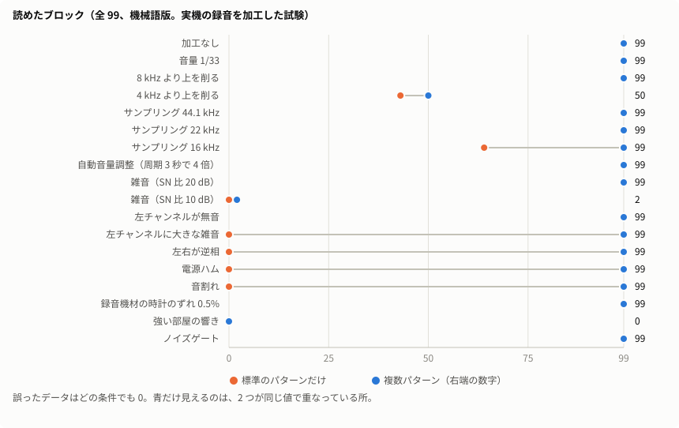

- **複数パターンが効く条件:** 片方のチャンネルが悪いとき、逆相、電源ハム、音割れ、低いサンプリング周波数では、「標準」で読めなくても別のパターンで読めます。
- **読めない条件:** SN 比 10 dB の雑音と、強い部屋の響きです。高音を 4 kHz で削ると半分ほどになります。
- **誤り:** どの条件でも誤ったデータは 0 でした。読めないときは「読めなかった」と報告します。

### BASIC 版

4 分の録音（約 35 ブロック）を使いました。

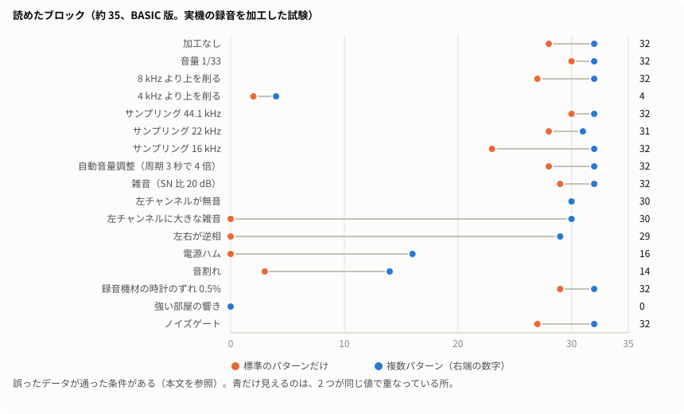

- **読める量:** 多くの条件で 30 ブロック前後です。4 kHz より上を削る、音割れ、電源ハムでは大きく減ります。強い部屋の響きは時間内に読めませんでした。
- **誤り:** 検査が弱いので、「標準」だけで読むと（`--single`）、誤ったデータが通った条件があります。サンプリング 22 kHz と時計のずれで、それぞれ 2 バイトです。複数パターン（既定）では、サンプリング 44 / 22 / 16 kHz と時計のずれのどれも 0 でした。サンプリング 32 kHz 未満の録音は、検査が通っても緑にしません。

確実を期すなら、機械語版か 2 回の録音を使ってください。

## 限界

- 大きな物音でブロックの大部分が潰れると、どの方法でも読めません。その範囲を録り直してください。
- 録音機材のノイズ抑制が強いと、ブザーの音そのものが消えることがあります。
- 強い雑音（SN 比 10 dB）と強い部屋の響きの中の録音は読めません。スマホをブザーに近づけ、静かな所で録音してください。
- 長い響きとビットの修復は、実機の録音でだけ確かめています。自動テストの合成音では再現できていません。
- BASIC 版の判定の値は PC-E500 の 1 本の録音で調整しました。
- CSAVE M の判定の値も、手元の数本の録音に合わせたものです。ビットの長さの比も実機の録音で測った値を初期値にしています。
- CSAVE M の物音の入ったブロックは、1 本の録音では直せません。もう 1 回録音してください。
