# How ROMDump analyzes the sound

[日本語](ANALYSIS.md)

> **This is an experimental application** and has not been sufficiently verified. Read the [README](../README_en.md#this-is-an-experimental-application) first.

This document follows what BeepDump does to turn a recording back into ROM bytes. The code is in [BeepDump/src/BeepDump.Core/](../BeepDump/src/BeepDump.Core/), and the numbers here are the constants in that code.

See [README_en.md](../README_en.md) for how to use it and [TECHNICAL_en.md](TECHNICAL_en.md) for a summary of the sound formats.

## Overview

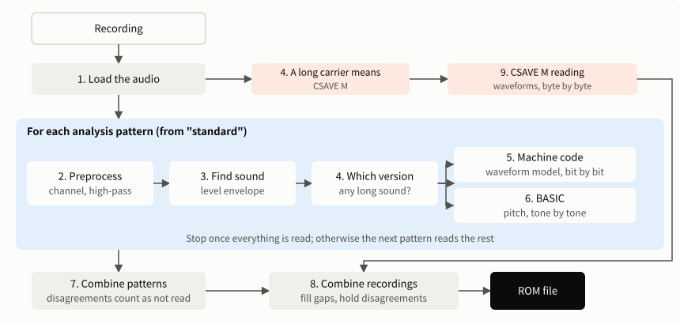

Three ideas run through the analysis.

- **The check has the final say.** Any one clue may or may not be reliable in a given recording, so many ways of reading are tried and only results that pass the check are used. As long as the check stops errors, adding ways of reading does not make the data less correct.
- **Learn from what was read.** The quirks of a model or a recording device (the buzzer's ring, BASIC's processing time) are not assumed. They are measured from blocks known to be correct.
- **Report what could not be read.** Asking for another recording is better than putting wrong data in the ROM.

## 1. Loading the audio

[AudioFile.cs](../BeepDump/src/BeepDump.Core/AudioFile.cs), [WavReader.cs](../BeepDump/src/BeepDump.Core/WavReader.cs)

| Format | How it is read |
|---|---|
| WAV (8/16/24/32-bit PCM, 32-bit float) | Built-in reader, with the same result on any OS |
| Others (Windows) | Converted to 16-bit PCM by Media Foundation |
| Others (Linux, Mac) | Converted to WAV by `ffmpeg` and read from a pipe |

The sample rate is used as recorded, with no conversion. Stereo channels are kept separately. For a video, only the audio is taken.

## 2. Preprocessing

`Prepare` in [Analyzer.cs](../BeepDump/src/BeepDump.Core/Analyzer.cs)

There are 11 analysis patterns, to absorb the differences between recording devices.

| # | Pattern | Channel | High-pass | Level smoothing | Detection threshold | Lookahead |
|---|---|---|---|---|---|---|
| 1 | Standard | Average | 800 Hz | No | 0.12 | 3 bits |
| 2 | Level smoothing | Average | 800 Hz | Yes | 0.12 | 3 |
| 3 | Left channel | Left | 800 Hz | No | 0.12 | 3 |
| 4 | Right channel | Right | 800 Hz | No | 0.12 | 3 |
| 5 | Left minus right (out-of-phase recording) | (L − R) / 2 | 800 Hz | No | 0.12 | 3 |
| 6 | Keep low frequencies | Average | 300 Hz | No | 0.12 | 3 |
| 7 | High frequencies only (low-frequency noise) | Average | 2000 Hz | No | 0.12 | 3 |
| 8 | Pick up quiet sound | Average | 800 Hz | No | 0.05 | 3 |
| 9 | Loud sound only (long reverberation) | Average | 800 Hz | No | 0.3 | 3 |
| 10 | Longer lookahead | Average | 800 Hz | No | 0.12 | 5 |
| 11 | Level smoothing + longer lookahead | Average | 800 Hz | Yes | 0.12 | 5 |

A mono recording skips the three patterns that use left and right. Lookahead only matters for the machine-code version, so the BASIC version skips 10 and 11 once it has read any blocks.

The BASIC version also skips 5, 6, 7, 8, and 9 once it has read any blocks. Its acceptance checks were tuned on standard sound, and changing the content or the division of the sound lets misreadings with an unchanged sum get past them. On a real recording and processed versions of it, wrong data passed with these patterns.

- **High-pass:** a 4th-order Butterworth filter. It removes low noise such as air conditioning and vibration of the desk.
- **Level smoothing:** multiplies by the inverse of the level (RMS) over each 0.2 seconds, to smooth slow changes such as a recorder's automatic gain control. To avoid amplifying silence, sections below 2% of the loudest section are not raised any further.

## 3. Finding where sound starts and stops

`Segmenter` in [Tones.cs](../BeepDump/src/BeepDump.Core/Tones.cs)

This looks only at level, not pitch.

1. About every 1/12000 second, compute the RMS over ±0.4 ms (the envelope).
2. Compute the "surrounding level": the maximum of the envelope over 0.1 seconds, averaged over 0.05 seconds.
3. Sound is on where the envelope is above the larger of:
   - The surrounding level × the detection threshold (0.12 by default)
   - 4 times the lowest 0.2% of the envelope of the whole recording (to stay above the noise in silence)
4. Short gaps are joined (under 4.5 ms for BASIC, 3.5 ms for machine code). BASIC also discards tones of 2.4 ms or less.

## 4. Telling which version made the sound

`FastDecoder.LooksFast`

Two or more bursts longer than 0.15 seconds mean machine code. A BASIC tone is well below that length.

Bursts quieter than 1/4 of the typical (median) burst are excluded here. Room noise before and after the program can also look like a long sound, and could be mistaken for the learning sequence.

## 5. Reading the machine-code version

[FastDecoder.cs](../BeepDump/src/BeepDump.Core/FastDecoder.cs)

### What makes it hard

The machine-code version runs at about 2400 bps, so a bit is only about 20 samples in a 48 kHz recording. The buzzer rings each time its output toggles, and the ring overlaps the following bits. How long it rings varies widely by model. On a PC-E500 it is around 1 ms. On a PC-U6000, with its different case, it is still clear at 6 ms, about 15 bits later.

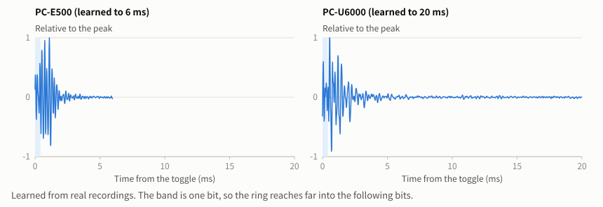

So the sound is explained with a waveform model:

```text
Recorded waveform = gain × Σ response(time − time of toggle k) + noise
```

The response is the waveform produced by one toggle. Rising and falling toggles have different shapes and are kept separately. Given the data, the toggle times are known, and the whole waveform can be computed.

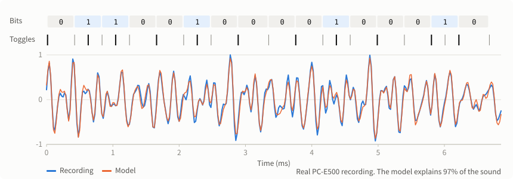

The code is biphase: every bit toggles at its head, and 1 bits also toggle in the middle. The toggle times follow from four values, in samples:

| Value | Meaning |
|---|---|
| T | Length of a 0 bit |
| M | From the head of a bit to its middle toggle |
| E | How much longer a 1 bit is than a 0 bit (4 cycles) |
| G | Extra time between data bytes (36 cycles) |

Other gaps come from G by the ratio of machine-code cycles (12, 7, and 48 around the sync, 42 from data to check, and 22 within the check).

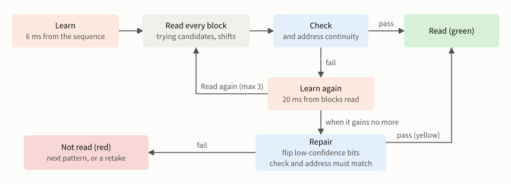

### 5.1 Learning from the learning sequence

A recording starts with sound whose content is known: `$00 $00 $5A` and the first 128 bytes of the machine code itself. The bit timing and the response come from this.

1. **First estimate of the bit length:** the leading `$00`s are periodic, so the period comes from a peak of the autocorrelation.
2. **Fitting over a growing span:** a tiny timing error builds up over a long span until the fit loses its grip. So fitting starts with the first 3 bytes and widens to 4, 5, 6, 8, 10, and so on, alternating two steps:
   - **Solve for the response:** with the toggle times fixed, the waveform is linear in the response, so least squares solves it (conjugate gradient).
   - **Solve for the timing:** with the response fixed, the start position, T, M, G, and E are updated together, explaining the residual with the slope of the waveform (Gauss-Newton). One update never moves a toggle by more than 1 sample.
3. **Telling the earlier machine code apart:** to keep reading recordings made before the machine code was fixed, the earlier sequence is also fitted, and the better fit is used.

The response at this stage is 6 ms long. The learning sequence lasts only 0.44 seconds, and fitting a longer response breaks down. Trying 20 ms on a real recording left no block readable.

### 5.2 Separating blocks

About 10 ms of silence separates blocks, and that normally divides them. A long ring or a noise can fill it, so that several blocks look like one burst (real PC-U6000 recordings had many runs of 2 to 6 blocks).

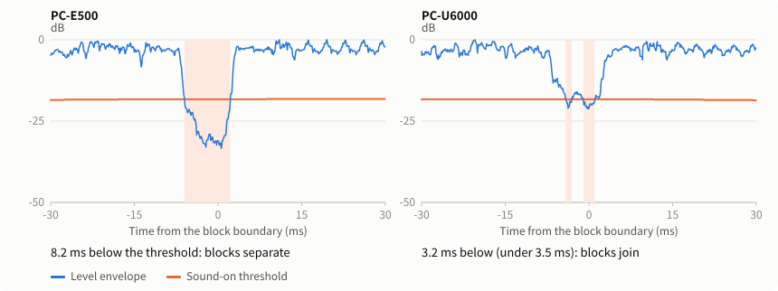

A block's length varies slightly with its data, but T, E, and G give its range. A burst that is too long is cut where the quietest 2 ms ends around that range, and that is where the next block starts. If the learning sequence joins the first block, its position comes from the ratio of bytes to a block, and it is cut the same way.

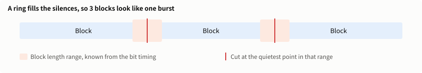

### 5.3 Finding candidate start positions

A block starts with three known bytes (`$00 $00 $A5`). These are tried at many positions to see how much of the recording they explain (every 0.5 samples, from −3 ms to +7 ms).

But `$00` is periodic, so good positions recur every two bits (about 40 samples), and the best one is not always the true start. On the PC-U6000 recordings, 95% of the unread blocks were this mistake. So the top 5 positions are kept as candidates, each with its own gain.

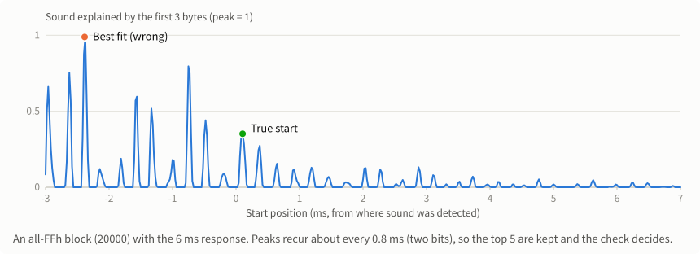

### 5.4 Deciding bit by bit

From a candidate start, this repeats (decision feedback with lookahead):

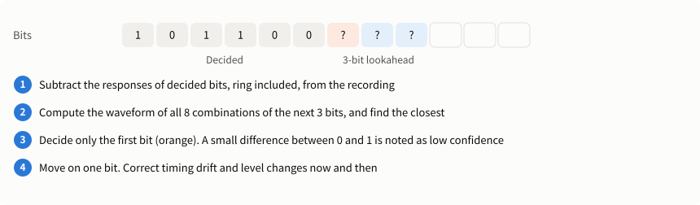

The smallest difference for 0 and for 1 are both recorded. A bit where they are close is a bit with low confidence, used later for repair.

Two corrections run while reading (every byte for the first 4 bytes, then every 4 bytes):

- **Timing drift:** from the part of the residual explained by the slope of the waveform. The clocks of the pocket computer and the recorder differ slightly, and this follows the difference.
- **Level change:** from the part of the residual explained by the waveform itself. A recorder's automatic gain control can change the level even within a block, and this follows it. Without it, a test with the level varying by a factor of 4 over a 3-second period read no blocks at all.

### 5.5 The check

This uses S1 and S2, described in [TECHNICAL_en.md](TECHNICAL_en.md).

- Address = S1 − the sum of the data. It fails if the low 8 bits are not 0
- It fails if the top byte of S1 or S2 is over 15 (they are 20 bits)
- It fails if the running sum computed from the data and address differs from S2
- The `$A5` sync is used for alignment, and its value is not checked

If the check fails, the other candidate starts are tried in combination with timing shifts between the sync and the data (±0.5, ±1, ±1.5 samples), and whichever passes is used.

### 5.6 Learning again from blocks already read

The correct data of a block already read makes it learning material. The response is extended to 20 ms and refitted, with the bit timing, from up to 16 blocks and the learning sequence (response, then timing, three times). Unread blocks are read again, repeating up to 3 times until it gains no more.

Blocks with the most varied values are chosen. Periodic sound such as all `FFh` cannot determine the response and makes reading worse (the PC-U6000's extension ROM is almost entirely `FFh`, and this did happen).

### 5.7 Checking addresses

S2 adds 256 times the address, so it does not see the upper 8 bits of the address. Misreading an upper bit of S1 gives a block with the right data at the wrong address, and the check still passes. This happened on real recordings: `2xxxx` blocks passed as `60000` and `90000`.

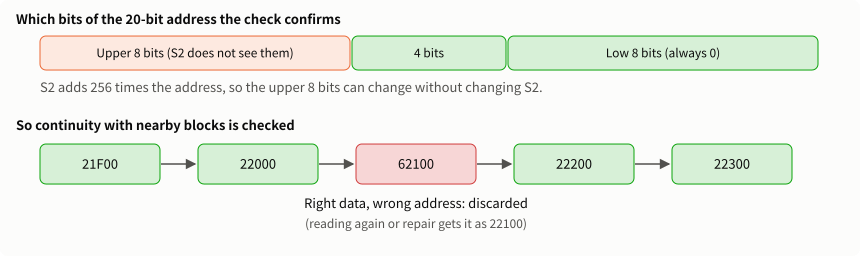

Blocks play in address order. Each block is compared with 4 blocks read on each side, and is discarded if more of them fail to continue its address than continue it.

All-`00h` data makes S2 zero, so the check could pass on unread sound with only an upper bit of S1 set. A block read as all `00h` is therefore used only if at least half of the sound is explained.

### 5.8 Repairing bits

Blocks still unread at this point often have only 1 or 2 wrong bits. Correct one, and reading continues correctly from there.

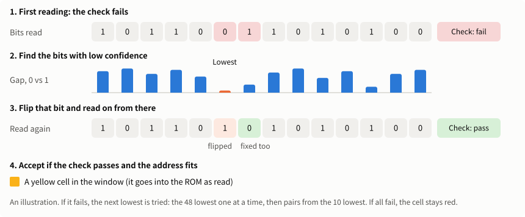

1. Read with the combinations of candidate start and timing shift, and take the one that leaves the least sound unexplained as the base.
2. Flip the 48 least confident bits one at a time and read again.
3. Failing that, flip two at a time from the 10 least confident (45 combinations).
4. Use the result if **it passes the check and its address matches the one given by nearby blocks**.

That is at most 93 attempts. The check has at least 28 bits (the low 8 bits of the address and the 20 bits of S2), so with the address match too, the chance of passing by accident is negligible. These are the yellow cells.

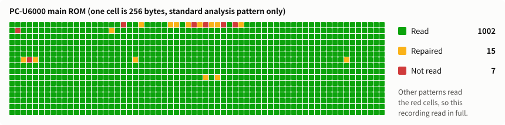

If more than 1/4 of the blocks are unread, no repair is tried. The recording itself has a problem, so the time would be poorly spent.

## 6. Reading the BASIC version

[Decoder.cs](../BeepDump/src/BeepDump.Core/Decoder.cs)

### What makes it hard

The BASIC version sends values by `BEEP` pitch. The period is `scale × (90 + 4 × value) / 256000` seconds, and a tone is 8 periods.

- **Short tones are hard to read.** A tone of value 0 lasts only about 3 ms even at 8 periods and has few harmonics, so it is easily misread at twice or 2/3 of its period.
- **The scale differs by machine.** No calibration tone is played, so it comes from the recording.
- **The check is weak.** It is a sum, so misreadings that cancel out pass.

### 6.1 Reading the period of one tone

`PeriodReader` finds the period from the series of harmonics.

1. Take the Fourier transform of the tone, padded with zeros to at least 16 times its length for fine resolution.
2. For a candidate period u, with base frequency `f0 = 256000 / u`, sum the power at the harmonics and subtract the power midway between them (up to the lower of 16 kHz and 0.45 times the sample rate).
3. Try candidates in steps of 0.5, and find the top of the highest peak by parabolic interpolation.

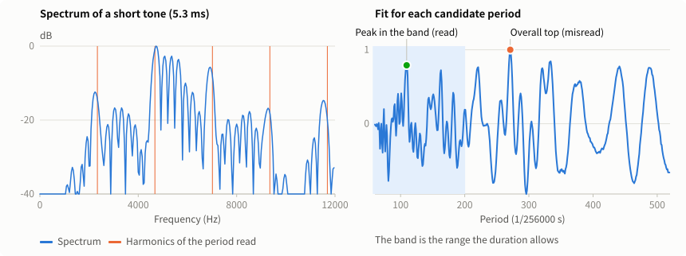

### 6.2 Narrowing down in stages

| Order | Step | Clue used |
|---|---|---|
| 1 | Read every tone | The tone's duration limits the period |
| 2 | Divide into blocks | A boundary has both a long interval and a long actual gap. Split blocks are rejoined to make 259 tones, and missed boundaries are split every 259 tones |
| 3 | Read again | The interval to the next tone limits the period. Processing time is found for each role in the block (address, data, check) |
| 4 | Find the scale | Below |
| 5 | Decide addresses | Below |
| 6 | Learn the scale and quirks | From blocks that pass the check |
| 7 | Read failed blocks again | Using what was learned (up to 3 times) |

**In step 3,** processing time varies now and then, so long tones with many harmonics are searched widely (±3 ms), and only short tones are narrowed (±1.2 ms).

### 6.3 Finding the scale

This uses the fact that periods lie on the lattice `scale × (90 + 4 × value)`.

1. Try scales from 0.70 to 1.10 in steps of 0.00002, and collect those where periods sit well on the lattice.
2. For each, read the first 40 blocks, counting how many pass the check and how many have an address continuing to the next block.
3. If tied, choose the one where periods for each value are least biased. In a range such as all `FFh`, the check still passes with every tone off by one.
4. If an earlier recording gave a scale, look only at candidates within ±0.002 of it. A short retake then cannot get the scale wrong.

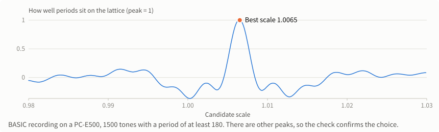

The scale also changes slightly during a recording (with temperature, for example), so it is followed block by block, smoothed by the median of blocks passing the check within 8 blocks on each side.

### 6.4 Deciding addresses

The BASIC address is recovered from the check values and "address ÷ 5000". Misreading a single tone can shift the address and still pass the check: reading a value of 6 as 1 reduces the sum by 5, giving an address 5 blocks away.

So the address is decided by a vote among the 16 blocks on each side. Block positions are counted from the number of tones, so even two joined blocks do not throw off the count.

### 6.5 Learning quirks

Blocks that pass the check teach these for each value. Values that do not appear are filled in from nearby values.

| Learned | Why |
|---|---|
| Bias of the reading | The reading is slightly off depending on the value |
| Processing time (interval − 8 periods) | BASIC's processing time varies with the value. On the PC-E500, value 13 is about 0.9 ms shorter |
| Duration − 8 periods | The ring |

For short tones (period under 250) in failed blocks, each value's fit to the harmonics is reduced by how far the expected interval and duration are off, to choose a peak. The value is then read from the top of that peak.

While a key is held, the interval lengthens by about 2.7 ms, so this is also treated as normal.

### 6.6 Accepting a block

Since the check is weak, these are also required (`Plausible`):

- The readings of the whole block are not biased off the lattice (median under 0.2 steps). A shift of every tone by one also shifts the check values and passes, and this stops that.
- For short tones (values under 46), the value and the duration agree within 1.3 ms.
- For short tones, the value and the interval to the next tone agree within 1.1 ms, allowing the 2.7 ms lengthening of a held key.

These three values were tuned on a real recording.

### 6.7 Repair

A failed block goes through these in order:

1. Read short tones again, limited by duration. The interval lengthens while a key is held and at the start of a run, but the duration does not change.
2. Replace each of the 10 least certain tones with its second choice, one at a time, and accept only if exactly one replacement passes the check.

Replacing two or more tones is not tried, because on a real recording that accepted wrong combinations that passed by accident.

## 7. Combining the patterns

`Analyze` in [Analyzer.cs](../BeepDump/src/BeepDump.Core/Analyzer.cs)

- Patterns run in order, stopping when blocks are contiguous and none is unread.
- For each block, votes are split by content, with 2 votes for one that passed as read and 1 for one repaired. A tie means not read.
- From the second pattern on, the machine-code version reads only blocks still missing, whose addresses follow from the order of blocks. About 32 blocks from across the recording are also read as learning material.
- The BASIC version learns timing from all tones, so it reads everything each time. Once it has read any blocks, it only uses the patterns that change the channel or smooth the level (2, 3, and 4).
- Three patterns in a row with no gain end the analysis, because a part ruined by noise will not be readable by another pattern. While nothing has been read, every pattern is tried.

## 8. Combining the recordings

[RomImage.cs](../BeepDump/src/BeepDump.Core/RomImage.cs)

| Situation | What happens |
|---|---|
| A block read for the first time | Used as it is |
| Same content as before | A repaired block is replaced by one that passed as read |
| Different content, one of them repaired | The one that passed as read is used |
| Different content, both treated alike | Both are held back and shown red. The content that agrees in a later recording is used |

## Summary of protection against errors

| Possible error | What prevents it | Version |
|---|---|---|
| A misread bit | The S1 and S2 check | Machine code |
| A wrong start position | Using the candidate that passes the check | Machine code |
| A misread upper address | Continuity with nearby blocks | Machine code |
| Reading silence as all 0 | Confirming the sound is explained | Machine code |
| Repair passing by accident | At most 2 flipped bits, and the address must match | Machine code |
| A shifted address | A vote among 16 blocks on each side | BASIC |
| Every tone off by one | How the scale is chosen, and the bias check | BASIC |
| Canceling misreadings | Checking against duration and interval | BASIC |
| Repair passing by accident | One tone only, and only if it is the sole candidate | BASIC |
| Disagreement between patterns or recordings | Majority vote and holding back | Both |

**Weaknesses that remain:** the BASIC check is a sum, so a misreading might still get past all of these. For certainty, use the machine-code version or two recordings. On the machine-code version, an error that passes both the check and address continuity cannot be ruled out either, although none has occurred on real recordings so far.

## What each stage gained on real recordings

These were measured during development on the PC-U6000 recordings. Each row adds to the processing in the rows above, and shows how many blocks were read.

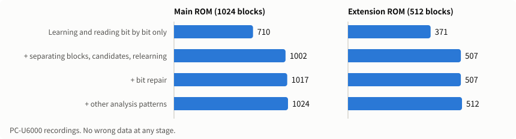

| Processing | Main ROM (1024 blocks) | Extension ROM (512 blocks) |
|---|---|---|
| Learning and bit-by-bit reading only | 710 | 371 |
| Separating blocks, candidate starts, learning again | 1002 | 507 |
| Bit repair | 1017 | 507 |
| Other analysis patterns | 1024 | 512 |

Neither had any wrong data, and the 384KB from the two recordings together matches `PC-U6000(8.4).ROM` byte for byte.

## Tolerance of recording devices

To try conditions like those of other devices, real recordings from a PC-E500 were processed and read. These are not recordings made on other real devices.

### Machine code

This used 99 blocks of the 15-minute recording.

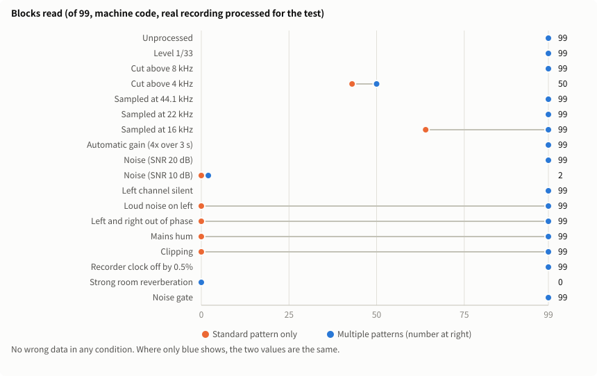

- **Where multiple patterns help:** with one bad channel, out-of-phase channels, mains hum, clipping, or a low sample rate, another pattern reads what "standard" cannot.
- **What cannot be read:** noise at an SNR of 10 dB and strong room reverberation. Cutting highs at 4 kHz leaves about half.
- **Errors:** no wrong data in any condition. What cannot be read is reported as not read.

### BASIC

This used a 4-minute recording (about 35 blocks).

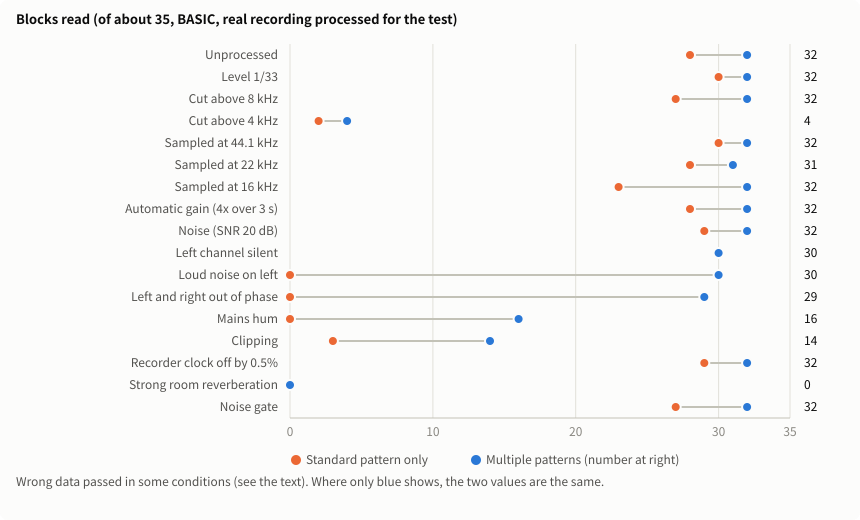

- **How much is read:** about 30 blocks in many conditions. Cutting above 4 kHz, clipping, and mains hum reduce it sharply. Strong reverberation could not be read in the time allowed.
- **Errors:** the check is weak, so wrong data passed in some conditions: 3 bytes with multiple patterns at a 16 kHz sample rate, and 2 bytes with the standard pattern alone at 22 kHz and with the clock off. The last two became 0 with the majority vote of multiple patterns.

For certainty, use the machine-code version or two recordings.

## Limits

- If a loud noise ruins most of a block, no method can read it. Record that range again.
- A recorder's strong noise suppression can remove the buzzer's sound itself.
- Recordings in strong noise (SNR 10 dB) or strong room reverberation cannot be read. Keep the phone close to the buzzer, in a quiet place.
- Long rings and bit repair have only been verified on real recordings. The synthetic sound of the automated tests does not reproduce them.
- The BASIC acceptance values were tuned on a single PC-E500 recording, so other models or recordings may not reach the same accuracy.
