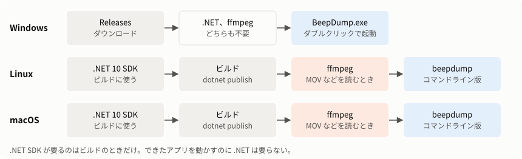
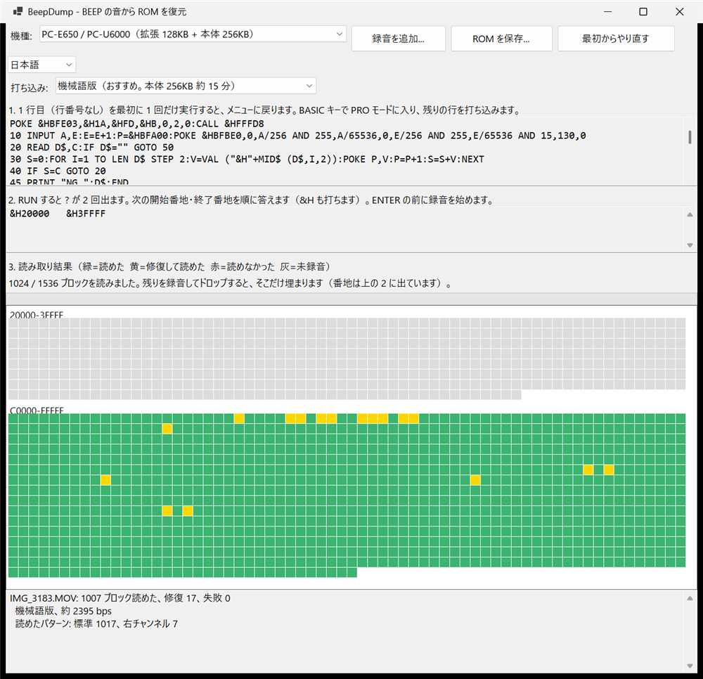

# インストール手順

[English](INSTALL_en.md)

> **実験的なアプリケーションです。** まだ十分に検証されていません。[README](../README.md#実験的なアプリケーションです) を先に読んでください。

BeepDump を使えるようにするまでの手順です。録音のしかたは [README](../README.md) を見てください。自分でビルドするときは [BUILD.md](BUILD.md) を見てください。



| OS | 使えるもの | 入手のしかた |
|---|---|---|
| Windows | 画面のあるアプリ（`BeepDump.exe`）、コマンドライン版（`beepdump.exe`） | [Releases](https://github.com/litchi-gh/pc-e500_beep_romdumper/releases) からダウンロード |
| Linux | コマンドライン版（`beepdump`） | [ビルド](BUILD.md) |
| macOS | コマンドライン版（`beepdump`、未確認） | [ビルド](BUILD.md) |

対応する OS やメモリの目安は [README の動作環境](../README.md#動作環境) にあります。動作を確認したのは Windows 11 と Linux（WSL の Ubuntu、x64）です。

## Windows

**.NET や ffmpeg のインストールは要りません。**

### 画面のあるアプリ

1. [Releases](https://github.com/litchi-gh/pc-e500_beep_romdumper/releases) を開きます。
2. 新しいリリースの Assets から `BeepDump.exe` をダウンロードします。
3. 好きなフォルダに置いて、ダブルクリックで起動します。

署名をしていないので、「Windows によって PC が保護されました」と出ることがあります。そのときは「詳細情報」→「実行」を選びます。

表示の言語は、機種の下の欄で切り替えられます。最初は Windows の言語に合わせ、選んだ言語を次回も使います。



### コマンドライン版

1. Assets から `beepdump-win-x64.zip` をダウンロードして展開します。
2. 中の `beepdump.exe` を好きなフォルダに置きます。

**`BeepDump.exe` と同じフォルダには置けません。** Windows のファイル名は大文字と小文字を区別しないので、同じファイルとして上書きされます。

### MOV などが読めないとき（Windows の N エディション）

N エディションには Media Foundation が入っていません。Media Feature Pack を入れるか、[ffmpeg](#ffmpeg) を入れます。ffmpeg があれば、Media Foundation で読めないときに自動で使います。WAV はどちらもなしで読めます。

| OS | 場所 |
|---|---|
| Windows 11 N | 設定 → アプリ → オプション機能 → 「機能を表示」→ Media Feature Pack |
| Windows 10 N | 設定 → アプリ → アプリと機能 → オプション機能 → 機能の追加 → Media Feature Pack |

## Linux

1. [BUILD.md](BUILD.md) のとおりに `beepdump` をビルドします。
2. 置きます。

   ```sh
   sudo install -m 755 app/cli/linux-x64/beepdump /usr/local/bin/beepdump
   beepdump --version
   ```

   ほかの PC でビルドしたファイルをコピーしたときも同じです。実行できないときは `chmod +x beepdump` を試してください。

3. MOV や M4A を読むときは [ffmpeg](#ffmpeg) を入れます。

動かすときに .NET は要りません。

## macOS

> **未確認:** Mac では一度も動かしていません。以下は一般的な手順で、このまま動くとは限りません。

1. [BUILD.md](BUILD.md) のとおりに `beepdump` をビルドします。
2. 置きます。

   ```sh
   sudo mkdir -p /usr/local/bin
   sudo install -m 755 app/cli/osx-arm64/beepdump /usr/local/bin/beepdump
   beepdump --version
   ```

   Intel の Mac では `osx-arm64` を `osx-x64` に換えます。ほかの PC でビルドしたファイルを持ってきて起動しないときは、次を試してください。

   ```sh
   xattr -d com.apple.quarantine beepdump   # ダウンロードの印を消す
   codesign --sign - beepdump               # Apple Silicon で必要な簡易署名
   ```

3. MOV や M4A を読むときは [ffmpeg](#ffmpeg) を入れます。

## ffmpeg

録音を WAV に変換するためのソフトです。BeepDump には含まれていません。

| 読む録音 | Windows | Linux、macOS |
|---|---|---|
| WAV | 不要 | 不要 |
| MOV、MP4、M4A など | 不要（N エディションを除く） | **必要** |

### 入れ方

| OS | コマンド |
|---|---|
| Windows | `winget install -e --id Gyan.FFmpeg` |
| Ubuntu、Debian | `sudo apt-get install -y ffmpeg` |
| Fedora | 下を参照 |
| macOS | `brew install ffmpeg`（[Homebrew](https://brew.sh/) が必要） |

- **Ubuntu:** `ffmpeg` は universe にあります。見つからないときは universe を有効にしてください。
- **Fedora:** 標準の `ffmpeg-free` は機能が絞られています。iPhone の録音（AAC）が読めないときは、RPM Fusion の ffmpeg に換えます。

  ```sh
  sudo dnf install https://mirrors.rpmfusion.org/free/fedora/rpmfusion-free-release-$(rpm -E %fedora).noarch.rpm https://mirrors.rpmfusion.org/nonfree/fedora/rpmfusion-nonfree-release-$(rpm -E %fedora).noarch.rpm
  sudo dnf swap ffmpeg-free ffmpeg --allowerasing
  ```

ほかの環境は [ffmpeg の公式サイト](https://ffmpeg.org/download.html)を見てください。

入れたら、**新しいターミナルを開き直して**確かめます。

```sh
ffmpeg -version
```

BeepDump は `PATH` にある `ffmpeg` を使います。

> **未確認:** 本物の ffmpeg で BeepDump を動かしたことはありません。確認したのは、WSL で試験用の代役を使って、渡す引数とパイプからの読み取りが動くことです。うまくいかないときは、次の方法で先に WAV に変換してください。

### 自分で WAV に変換する

`ffmpeg` を入れられない PC では、別の PC で WAV に変換して持ってくれば読めます。

```sh
ffmpeg -i IMG_3183.MOV -vn -c:a pcm_s16le IMG_3183.wav
```

音量を変えたり、サンプリング周波数を下げたりする変換はしないでください。

## 動いているか確かめる

コマンドライン版は次の順に確かめます。

```sh
beepdump --version          # beepdump 0.1.0 のように出る
beepdump listing --basic    # 打ち込むリストが出る
beepdump decode -o test.rom 録音.wav
```

`decode` の終了コードは、全部読めたら 0、足りなければ 1、エラーは 2 です。録音が範囲の一部だけだと、足りない範囲が表示されて 1 になります。

## ポケコン側の準備

ポケコンにインストールするものはありません。[README](../README.md#1-プログラムを入れる) のとおりにプログラムを打ち込みます。CE-140F（またはその代わりになるもの）があれば、`BASIC/BEEPFAST.BAS` か `BASIC/BEEPDUMP.BAS` を SD カードなどにコピーして `LOAD` できます。

## アンインストール

| 消すもの | 場所 |
|---|---|
| アプリ | `BeepDump.exe` か `beepdump` のファイル（Linux、macOS は `sudo rm /usr/local/bin/beepdump`） |
| 言語の設定（Windows） | `%LOCALAPPDATA%\BeepDump` フォルダ |

レジストリは使いません。ffmpeg は、ほかのソフトも使うことがあるので、不要なときだけ消してください。

## 困ったとき

| 症状 | 確かめること |
|---|---|
| 「Windows によって PC が保護されました」 | 「詳細情報」→「実行」を選びます |
| `ffmpeg` が見つからない | 入れたあと、ターミナルを開き直してください |
| `Reading ... needs ffmpeg` | [ffmpeg](#ffmpeg) を入れるか、WAV に変換してください |
| `Could not read the audio`、「音声を読めませんでした」 | ファイルが壊れていないか、音声が入っているかを確かめてください |
| 「Media Foundation がありません」 | Windows の N エディションです。[この節](#mov-などが読めないときwindows-の-n-エディション) を見てください |
| `Permission denied` | `chmod +x beepdump` を実行してください |
| Mac で起動してすぐ終了する、開発元を確認できないと出る | [macOS](#macos) の 2 つのコマンドを試してください |
| 読めるけれど赤いマスが多い | インストールの問題ではありません。[README の困ったとき](../README.md#困ったとき)を見てください |
