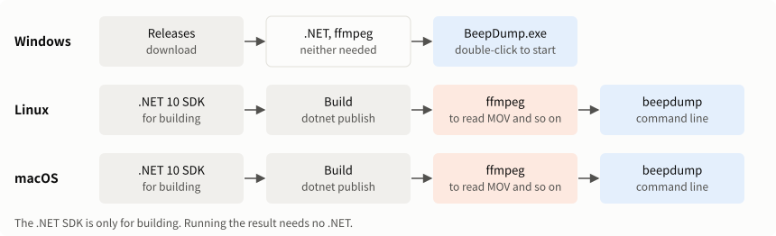
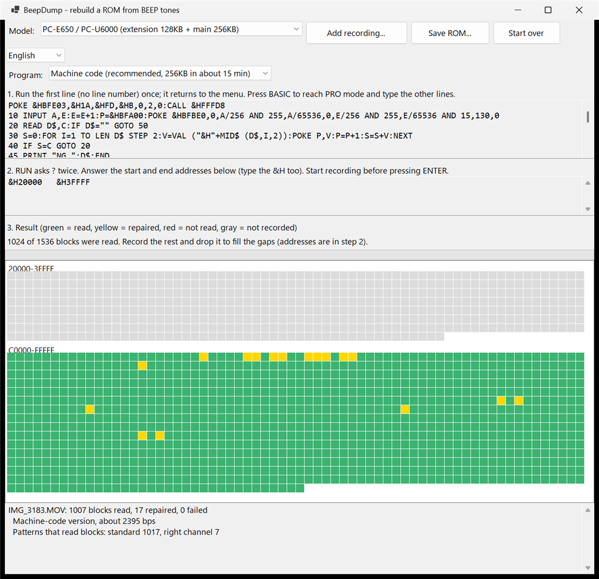

# Installation guide

[日本語](INSTALL.md)

> **This is an experimental application** and has not been sufficiently verified. Read the [README](../README_en.md#this-is-an-experimental-application) first.

How to get BeepDump running. See the [README](../README_en.md) for how to record, and [BUILD_en.md](BUILD_en.md) to build it yourself.



| OS | Available | How to get it |
|---|---|---|
| Windows | Windowed application (`BeepDump.exe`), command-line version (`beepdump.exe`) | Download from [Releases](https://github.com/litchi-gh/pc-e500_beep_romdumper/releases) |
| Linux | Command-line version (`beepdump`) | [Build it](BUILD_en.md) |
| macOS | Command-line version (`beepdump`, untested) | [Build it](BUILD_en.md) |

See [System requirements in the README](../README_en.md#system-requirements) for supported OS versions and memory. It has been run on Windows 11 and on Linux (Ubuntu on WSL, x64).

## Windows

**You do not need to install .NET or ffmpeg.**

### Windowed application

1. Open [Releases](https://github.com/litchi-gh/pc-e500_beep_romdumper/releases).
2. Under Assets of the latest release, download `BeepDump.exe`.
3. Put it in any folder and double-click it.

It is not signed, so "Windows protected your PC" may appear. If so, choose "More info", then "Run anyway".

The selector below the model switches the language. It starts with the language of Windows and remembers your choice.



### Command-line version

1. Under Assets, download `beepdump-win-x64.zip` and extract it.
2. Put the `beepdump.exe` inside in any folder.

**It cannot share a folder with `BeepDump.exe`.** Windows file names ignore case, so one would overwrite the other.

### If MOV and similar files cannot be read (Windows N editions)

N editions do not include Media Foundation. Install the Media Feature Pack or [ffmpeg](#ffmpeg). If ffmpeg is present, it is used automatically when Media Foundation cannot read a file. WAV works with neither.

| OS | Where |
|---|---|
| Windows 11 N | Settings → Apps → Optional features → "View features" → Media Feature Pack |
| Windows 10 N | Settings → Apps → Apps & features → Optional features → Add a feature → Media Feature Pack |

## Linux

1. Build `beepdump` as in [BUILD_en.md](BUILD_en.md).
2. Put it in place.

   ```sh
   sudo install -m 755 app/cli/linux-x64/beepdump /usr/local/bin/beepdump
   beepdump --version
   ```

   The same applies to a file built on another PC and copied over. If it will not run, try `chmod +x beepdump`.

3. To read MOV and M4A, install [ffmpeg](#ffmpeg).

Running it needs no .NET.

## macOS

> **Untested:** it has never been run on a Mac. These are general steps, and may not work as written.

1. Build `beepdump` as in [BUILD_en.md](BUILD_en.md).
2. Put it in place.

   ```sh
   sudo mkdir -p /usr/local/bin
   sudo install -m 755 app/cli/osx-arm64/beepdump /usr/local/bin/beepdump
   beepdump --version
   ```

   On an Intel Mac, replace `osx-arm64` with `osx-x64`. If a file built on another PC will not start, try these:

   ```sh
   xattr -d com.apple.quarantine beepdump   # remove the download mark
   codesign --sign - beepdump               # the ad-hoc signature Apple Silicon needs
   ```

3. To read MOV and M4A, install [ffmpeg](#ffmpeg).

## ffmpeg

ffmpeg converts recordings to WAV. It is not included with BeepDump.

| Recording | Windows | Linux, macOS |
|---|---|---|
| WAV | Not needed | Not needed |
| MOV, MP4, M4A, and others | Not needed (except N editions) | **Needed** |

### Installing it

| OS | Command |
|---|---|
| Windows | `winget install -e --id Gyan.FFmpeg` |
| Ubuntu, Debian | `sudo apt-get install -y ffmpeg` |
| Fedora | See below |
| macOS | `brew install ffmpeg` (needs [Homebrew](https://brew.sh/)) |

- **Ubuntu:** `ffmpeg` is in universe. If it is not found, enable universe.
- **Fedora:** the standard `ffmpeg-free` has reduced features. If iPhone recordings (AAC) cannot be read, switch to the RPM Fusion ffmpeg.

  ```sh
  sudo dnf install https://mirrors.rpmfusion.org/free/fedora/rpmfusion-free-release-$(rpm -E %fedora).noarch.rpm https://mirrors.rpmfusion.org/nonfree/fedora/rpmfusion-nonfree-release-$(rpm -E %fedora).noarch.rpm
  sudo dnf swap ffmpeg-free ffmpeg --allowerasing
  ```

For other systems, see the [ffmpeg website](https://ffmpeg.org/download.html).

Then **open a new terminal** and confirm:

```sh
ffmpeg -version
```

BeepDump uses the `ffmpeg` on your `PATH`.

> **Untested:** BeepDump has never been run with the real ffmpeg. What has been tested, with a stand-in on WSL, is the arguments it passes and reading from the pipe. If it does not work, convert to WAV first as below.

### Converting to WAV yourself

On a PC where you cannot install `ffmpeg`, convert on another PC and bring the WAV over.

```sh
ffmpeg -i IMG_3183.MOV -vn -c:a pcm_s16le IMG_3183.wav
```

Do not change the level or lower the sample rate in the conversion.

## Confirming it works

Check the command-line version in this order:

```sh
beepdump --version          # prints something like beepdump 0.1.0
beepdump listing --basic    # prints the listing to type in
beepdump decode -o test.rom recording.wav
```

The exit code of `decode` is 0 if everything was read, 1 if some is missing, and 2 on an error. A recording of part of the range lists the missing ranges and gives 1.

## On the pocket computer

Nothing is installed on the pocket computer. Type in the program as in the [README](../README_en.md#1-enter-the-program). With a CE-140F or a replacement, copy `BASIC/BEEPFAST.BAS` or `BASIC/BEEPDUMP.BAS` to an SD card or similar and `LOAD` it.

## Uninstalling

| What | Where |
|---|---|
| The application | The `BeepDump.exe` or `beepdump` file (on Linux and macOS, `sudo rm /usr/local/bin/beepdump`) |
| The language setting (Windows) | The `%LOCALAPPDATA%\BeepDump` folder |

The registry is not used. ffmpeg may be used by other software, so remove it only if you no longer need it.

## Troubleshooting

| Symptom | What to check |
|---|---|
| "Windows protected your PC" | Choose "More info", then "Run anyway" |
| `ffmpeg` is not found | Open a new terminal after installing |
| `Reading ... needs ffmpeg` | Install [ffmpeg](#ffmpeg), or convert to WAV |
| `Could not read the audio` | Check that the file is intact and has audio |
| `This Windows has no Media Foundation` | This is a Windows N edition. See [this section](#if-mov-and-similar-files-cannot-be-read-windows-n-editions) |
| `Permission denied` | Run `chmod +x beepdump` |
| On a Mac it exits at once, or says the developer cannot be verified | Try the two commands under [macOS](#macos) |
| It reads, but with many red cells | This is not an installation problem. See [Troubleshooting in the README](../README_en.md#troubleshooting) |
