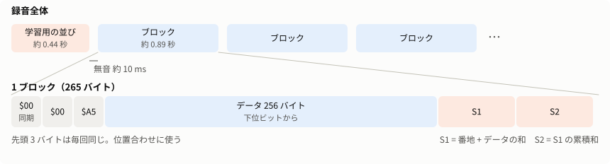
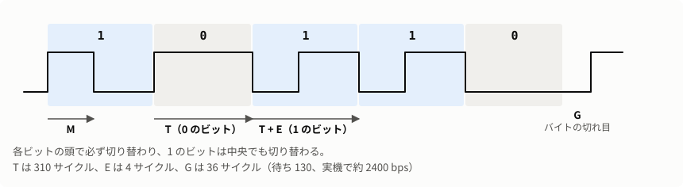
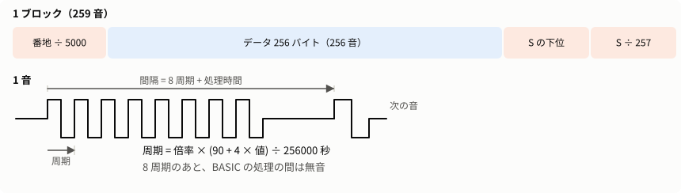
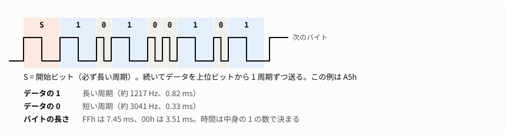

# ROMDump 技術資料

[English](TECHNICAL_en.md)

> **実験的なアプリケーションです。** まだ十分に検証されていません。[README](../README.md#実験的なアプリケーションです) を先に読んでください。

使い方は [README.md](../README.md) を見てください。ここには、音の形式、確かめたこと、ビルドの方法をまとめます。

方式は 3 つあります。機械語版と BASIC 版はこのプロジェクトのプログラムで、音の形式もこちらで決めました。CSAVE M は本体の BASIC の命令で、音の形式は実機とエミュレータの音から調べました。

## 機械語版の音の形式

[fast/beepfast.asm](../fast/beepfast.asm)（150 バイト）がブザーを直接切り替えます。



符号はバイフェーズです。各ビットの頭で必ず出力を反転し、ビットが 1 なら中央でも反転します。下位ビットから送ります。



1. 最初に 1 回、学習用の並びを出します: 無音、`$00`、`$00`、`$5A`、機械語自身の先頭 128 バイト。
2. 続いて 256 バイトごとに、次の順で出します。

   | 順番 | 内容 |
   |---|---|
   | 1 | 無音（8000 サイクル、実機で約 10ms） |
   | 2 | `$00`、`$00`、`$A5` |
   | 3 | データ 256 バイト |
   | 4 | S1（3 バイト、下位が先）: 番地とデータの和 |
   | 5 | S2（3 バイト、下位が先）: S1 の累積和 |

S1・S2 は 20 bit です。番地は送らず、S1 から逆算します。番地の下位 8 bit が 0 になること、S2 が合うことが検査です。

S2 は番地の 256 倍を足す形なので、番地の上位 8 bit を見ていません。S1 の上位のビットを読み違えると、データは正しいまま番地だけ違うブロックとして検査が通ります。実機の録音で実際に起きました（下の「読み取り」の 5）。

ブロックの切れ目で ON キーを見て（`SSR` のビット 3）、押されていれば BASIC に戻ります。`ISR` のビット 3 は使いません。実機の PC-U6000 で、前に押した記録が残っていたとみられ、学習用の並びだけで終わったことがあったからです。

### 時間

サイクル数の比は機械語で決まります。

| 場所 | 余分なサイクル |
|---|---|
| 1 のビット（0 のビットより） | 4 |
| データのバイトの切れ目 | 36 |
| 先頭の `$00`→`$00`、`$00`→同期 | 12、7 |
| 同期→データ | 48 |
| データ→検査値 | 42 |
| 検査値の中 | 22 |

ビットの長さは 310 サイクルです（待ち 130 のとき）。実機は約 76 万サイクル/秒なので約 2400bps です。エミュレータは同じサイクル数を 102.4 万サイクル/秒で数えるので、約 3200bps になります。

### 速度の変え方

BASIC の 15 行にある `POKE` の、最後から 2 番目の数字（規定は 130）が半ビットの待ちです。ビットの長さは約 `2 × 待ち + 50` サイクルなので、100 にすると約 3000bps になります。**実機で確かめたのは 130 だけです。** 速くするほど前の音の響きが次のビットに重なるので、短い範囲で試してください。

### 読み取り

詳しくは [ANALYSIS.md](ANALYSIS.md) を見てください。ここでは流れだけを示します。

ビットの間隔が短く、切り替えの響きが次のビットに重なります。響きの長さは機種で違います。PC-E500 は 1ms 程度ですが、筐体の違う PC-U6000 は 6ms でもはっきり残り、ブロックの間の無音（約 10ms）が埋まることがあります。

1. **学習:** 学習用の並びから、ビットの時間とブザーの応答（切り替え 1 回の波形）を 6ms 分求めます。立ち上がりと立ち下がりは別に求めます。実機では立ち上がりの方が強く出ます。
2. **ブロックの切り出し:** 無音で切ります。無音が埋まってつながった塊は、ビットの時間から分かるブロックの長さの前後で、いちばん静かな所で切ります。学習用の並びと最初のブロックがつながったときも同じです。録音の前後の部屋の雑音は、音量の差で除きます。
3. **1 ビットずつ決める:** 応答を使って前の切り替えの響きを差し引き、次の 3 ビットまで候補を比べます。読みながら時計のずれと音量の変化を追います。
   - 先頭の `$00` は周期的な音なので、合う開始位置がビット 2 つ分ごとに現れ、いちばん合う位置が本当の開始とは限りません。候補を 5 つ残し、検査の通るものを採ります。候補の時間も少しずつずらします。
4. **覚え直し:** 読めたブロックの正しいデータを使って、応答を 20ms 分に伸ばしてビットの時間とともに求め直し、読めなかったブロックを読み直します。読めるものが増える間くり返します（最大 3 回）。全部 `FFh` のような周期的な音からは応答が決まらないので、値がばらけたブロックを選びます。
5. **番地の確認:** 近くの読めたブロックと番地がつながらないものは捨てます。
6. **修復:** それでも読めないブロックは、前後から番地が分かります。自信の低いビットを 1 つずつ（上位 48 個）、または 2 つ組で（上位 10 個）反転して読み直し、検査が通って番地も合えば採ります。黄色のマスです。

全部 `00h` のデータは S2 も 0 になり、読めていなくても S1 の上位が立つだけで検査が通ります。音を説明できていないとき（残りの音が半分より大きいとき）は採りません。

## BASIC 版の音の形式



1 音は 8 周期です。周期は `(90 + 4 × 値) / 256000` 秒で、機械ごとの倍率がかかります（PC-U6000 は 1.007 倍、PC-E500 は 1.0065 倍でした）。

1 ブロックは 259 音です。

| 順番 | 音の値 |
|---|---|
| 1 | 番地 ÷ 5000（切り捨て） |
| 2〜257 | データ 256 バイト |
| 258 | S の下位 8 bit（S = 番地の bit8〜15 + データの和） |
| 259 | S ÷ 257（切り捨て） |

式は BASIC の制限に合わせています。

- `BEEP` の高さは 255 を少しでも超えるとエラーになるので、`/4096` や `/256` は使えません。
- `AND` は 32767 までなので、最大 65535 の S は 32768 を引いてから `AND` します。

### 読み取り

詳しくは [ANALYSIS.md](ANALYSIS.md) を見てください。

倍音から周期を求めて、値に直します。短い音は周期の 2 倍や 2/3 に読み違えやすいので、次の音までの間隔と音の長さも使います。

- BASIC の処理時間は値によって変わります（PC-E500 で値 13 は他より約 0.9ms 短い）。検査の通ったブロックから値ごとの処理時間と音の長さを覚えます。
- 倍率は録音ごとに、検査値の通り方と、値の違う音同士の周期の比から決めます。全部 `FFh` の範囲では、全部の音が 1 段ずれても検査値が通るからです。前の録音で倍率が分かっていれば、それを使います。
- キーを押している間は、間隔が約 2.7ms 伸びます。

### 検査の弱点

検査値は和なので、次の読み違いは検査だけでは見つかりません。どちらも実機の録音で実際に起きました。

- **番地のずれ:** 値 6 を 1 と読むと和が 5 減り、番地を逆算すると 5 ブロック先になって検査も通ります。そこで番地は前後のブロックの多数決で決め、票が足りなければ「読めなかった」にします。
- **増減の打ち消し合い:** 値 2 と 13 が入れ替わるように読むと、和が変わりません。そこで短い音（値 46 未満）は、読んだ値と音の長さ・間隔が矛盾するブロックを受け入れません。

これで誤りが完全になくなるわけではありません。確実を期すなら、機械語版か 2 回の録音を使ってください。機械語版は累積和があるので、入れ替わりも見つかります。

## CSAVE M の音の形式

`CSAVE M 開始番地,終了番地` は、メモリの範囲をカセットに保存する BASIC の命令です。取扱説明書には載っていません。実機ではブザーからも音が出るので、プログラムを打ち込まずに ROM を鳴らせます。名前を付けるときは `CSAVE M "名前",開始番地,終了番地` と書きます。`SAVE M "CAS:..."` の形は `Bad drive name` になります。


1 周期が 1 ビットです。



### 時間

48 kHz の録音で実機を測った値です。機種や個体で少し違います（実機 5 台の本体 ROM で 1593〜1616 bps）。

| 場所 | 半周期（サンプル） | 周波数 |
|---|---|---|
| 搬送音 | 約 8.04 | 約 2986 Hz |
| データの 1 | 約 19.72 | 約 1217 Hz |
| データの 0 | 約 7.89 | 約 3041 Hz |
| バイトの切れ目の隙間 | 約 2.71 サンプル | |

1 バイトの時間は 1 のビットの数だけで決まります。FFh は 7.45 ms、00h は 3.51 ms です。本体 ROM 256KB は約 22 分、FFh の多い拡張 ROM 128KB は約 16 分でした。

### ヘッダ

50 バイトです。

| バイト | 内容 |
|---|---|
| 0 | `01h` |
| 1〜16 | 名前（足りない分は空白） |
| 17 | `0Dh` |
| 18、19、29 | 長さ（下位、中位、上位） |
| 20、21、30 | 開始番地（下位、中位、上位） |
| 22、23、31 | 実機では機械によって値が変わる。エミュレータでは `FFh` |
| 24〜28、32〜48 | 0 |
| 49 | 0〜48 番目のバイトの 1 のビットの数（下位 8 bit） |

### 本体

データの後ろに、データ全体の 1 のビットの数が 2 バイト（上位が先）付きます。番地もブロックごとの検査値もありません。

### 検査の弱点

検査値は 1 のビットの数だけなので、隣り合うビットの入れ替わりは見つかりません。開発の途中で、実機の録音でもこの形の読み違いが起きました。そこで BeepDump は、1 回の録音で読めたブロックをすべて黄色にして、別の録音と一致して初めて緑にします。

### 読み取り

詳しくは [ANALYSIS.md](ANALYSIS.md#9-csave-m-の読み取り) を見てください。音をブザーの応答の重ね合わせとして扱い、1 バイトごとに 256 通りの波形と比べて読みます。解析パターンは使いません。

## 複数の解析パターン

機械語版と BASIC 版の話です。録音機材によって音の録れ方が違うので、チャンネル、高域通過の周波数、音量のならし、音の検出のしきい値、先読みの長さを変えた 11 通りの解析を用意しました（`Analyzer.Patterns`）。

- 「標準」から順に試し、全部読めたらそこで止めます。
- 機械語版の 2 つ目以降のパターンでは、読めていないブロックだけを読みます（学習に使うブロックは別に少し読みます）。
- 3 パターン続けて増えなければ打ち切ります。物音で潰れた所は、ほかのパターンでも読めないからです。
- パターンの間で内容が違うブロックは「読めなかった」にします。同じ音声を読むので、数が多くても確認にならないからです。
- 機械語版の 2 つ目以降のパターンは、最初に読めた音の範囲だけを読みます。音量をならすと録音の前後の雑音が音に見え、そこから学ぶと全部のブロックの読み直しを繰り返すからです。

## 確かめたこと

### 実機

| 版 | 機種 | 録音 | 結果 |
|---|---|---|---|
| 機械語版 | PC-E500 | 本体全部、15.3 分、iPhone の動画の音声 | 1024 / 1024 ブロック。手元の ROM イメージと全バイト一致 |
| 機械語版 | PC-U6000 | 本体全部、15.5 分、iPhone の動画の音声 | 1024 / 1024 ブロック（修復 13）。読めたブロックの誤りは 0 |
| 機械語版 | PC-U6000 | 拡張全部、8.1 分、iPhone の動画の音声 | 512 / 512 ブロック。本体と合わせて手元の ROM イメージと 384KB 全バイト一致 |
| BASIC 版 | PC-E500 | 30 分で打ち切り（73KB） | 286 ブロック中 276（修復 9）。読めた部分の誤りは 0 |

BASIC 版の読み取りはこの録音に合わせて調整しました。

CSAVE M は次のとおりです。どれも iPhone の動画の音声で、読めたブロックを手元の ROM イメージと比べました。**誤ったデータは 8 本とも 0 バイトです。**

| 機種 | 範囲 | 録音の長さ | 読めたブロック | 読めなかった |
|---|---|---|---|---|
| PC-E500 | 本体 | 22.2 分 | 1024 / 1024 | 0 |
| PC-E550 | 本体 | 22.1 分 | 1024 / 1024 | 0 |
| PC-1480U | 本体 | 22.4 分 | 1024 / 1024 | 0 |
| PC-E650（1 回目） | 本体 | 22.2 分 | 1017 / 1024 | 7 |
| PC-E650（2 回目） | 本体 | 22.3 分 | 1024 / 1024 | 0 |
| PC-E650 | 拡張の `30000`〜`3FFFF` | 8.1 分 | 256 / 256 | 0 |
| PC-U6000 | 本体 | 22.2 分 | 1020 / 1024 | 4 |
| PC-U6000 | 拡張全部 | 16.1 分 | 512 / 512 | 0 |

- **PC-E650:** 3 本を合わせると、録音した 320KB が手元の ROM イメージと全バイト一致しました。`20000`〜`2FFFF` は録音しておらず、`FFh` で埋まっています（手元の ROM イメージも全部 `FFh` です）。
- **読めなかったブロック:** どれも物音の所で、録り直せば埋まります。
- **検査値:** PC-E650 の 2 回目は、データが全部正しいのに「全体の検査値が合いません」と出ます。検査値の 2 バイトだけを読み違えています。
- **PC-E500:** CSAVE M と機械語版の録音を合わせると、1024 ブロックすべてが一致して緑になり、ROM イメージと全バイト一致しました（読み取りを調整する途中の版で確認）。

CSAVE M の読み取りは、これらの録音に合わせて調整しました。

### エミュレータ

`BEEPFAST.BAS` を `LOAD` し、`BEEPDUMP.TXT` をキー入力して動かしました。対象は手元の 7 機種の ROM すべて（RAM 32KB と 64KB。PC-E650 と PC-U6000 は 64KB のみ）です。

- **機械語版:** `FF000`〜`FF7FF` の 8 ブロック。音を直接解いても BeepDump で読んでも、すべて ROM と一致しました。
- **BASIC 版:** `FF000`〜`FF2FF` の 3 ブロック。BeepDump で 2 または 3 ブロック読めて、誤りは 0 でした。
- **`BEEPDUMP.BAS`:** PC-E500 と PC-U6000 で `LOAD` して動かしました。結果は BASIC 版と同じです。
- **CSAVE M:** 手元の ROM すべての本体と、PC-E650 と PC-U6000 の拡張で、音をビット列に戻して ROM と全バイト一致しました。形式を調べるための確認で、BeepDump の読み取りを通したものではありません。

エミュレータは時間が実機と違います（上の「時間」）。速度の判断には使えません。

### 自動テスト

`BeepDump\build.ps1` で合成音のテストが動きます。

- 機械語版: 全ブロックを読めること。
- BASIC 版: 誤ったデータを受け入れないことと、大半を読めること。読み取りを実機の録音に合わせて厳しくしたので、合成音では読めないブロックが出ることがあります。
- CSAVE M: 誤ったデータを出さないことと、読めること。サンプリング周波数、モノラル、時計のずれ、FFh の並び、途中で切れた録音などを試します。1 回の録音で緑にならないことも確かめます。

長い響き（合成音の応答では学習がうまくいきません）とビットの修復（合成音の雑音では誤りが広がり、修復が働きません）は、実機の録音で確かめました。

## ビルド

SDK の入れ方や OS ごとの手順は [BUILD.md](BUILD.md) を見てください。コマンドはリポジトリの一番上のフォルダで実行します。

```powershell
BeepDump\build.ps1            # テストのあと BeepDump\app\BeepDump.exe と BeepDump\app\cli\win-x64\beepdump.exe を作る（単体で動く）
BeepDump\build.ps1 -Cli       # さらに BeepDump\app\cli に Linux と Mac 用の beepdump を作る
BeepDump\build.ps1 -TestOnly  # テストだけ
py fast\build.py              # 機械語を変えたとき。BASIC\ の BEEPFAST.* と画像、両方の README のリスト、FastCode.cs を作り直す
```

`py fast\build.py` には `e500asm`、`ce140conv`、Python の Pillow が必要です（[BUILD.md](BUILD.md)）。

Linux と Mac では .NET 10 SDK があれば、そのまま動かせます。

```sh
dotnet run --project BeepDump/src/BeepDump.Cli -c Release -- decode 録音.wav
```

コマンドラインの使い方は `beepdump --help` か [README](../README.md#コマンドライン版) を見てください。`decode --trace ファイル` は BASIC 版の音ごとの読み取り結果を、`decode --single` は「標準」のパターンだけの結果を出します。

## ファイル

| ファイル | 内容 |
|---|---|
| [BASIC/BEEPFAST.TXT](../BASIC/BEEPFAST.TXT) | 機械語版。`fast/build.py` が作る |
| [BASIC/BEEPFAST.BAS](../BASIC/BEEPFAST.BAS) | CE-140F の `LOAD` 用（領域を確保する 1 行目は入らない）。末尾に `0x1A` を付けない（`Sharp_ce140f_emul` は自分で送るので、2 回届いてエラーになる） |
| [BASIC/BEEPDUMP.TXT](../BASIC/BEEPDUMP.TXT) | BASIC 版 |
| [BASIC/BEEPDUMP.BAS](../BASIC/BEEPDUMP.BAS) | CE-140F の `LOAD` 用。`fast/build.py` が作る |
| `BASIC/*.png` | 2 つのリストを 40 文字で折り返した画像。`fast/build.py` が作る |
| [fast/](../fast/) | 機械語のソースと、BASIC を作るスクリプト |
| [BeepDump/src/BeepDump/](../BeepDump/src/BeepDump/) | Windows アプリ（日本語と英語） |
| [BeepDump/src/BeepDump.Cli/](../BeepDump/src/BeepDump.Cli/) | コマンドライン版（英語、Windows・Linux・Mac） |
| [BeepDump/src/BeepDump.Core/](../BeepDump/src/BeepDump.Core/) | 読み取りの本体。どの OS でも動く |
| [BeepDump/tests/](../BeepDump/tests/) | 自動テスト |
| [INSTALL.md](INSTALL.md) | インストール手順 |
| [BUILD.md](BUILD.md) | ビルド手順 |
| [ANALYSIS.md](ANALYSIS.md) | 解析の詳細 |
| [figures/](figures/) | 文書の図。`build_figures.py` が SVG を作る。グラフのデータは `extract_data.py` が実機の録音から測った `data.json` |
