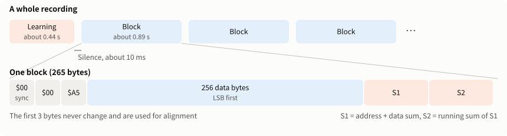
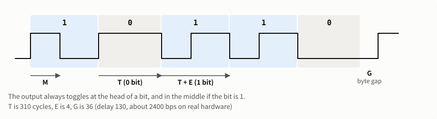
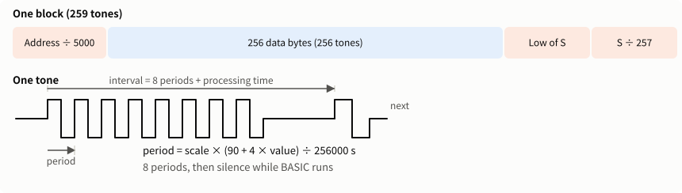

# ROMDump technical notes

[日本語](TECHNICAL.md)

> **This is an experimental application** and has not been sufficiently verified. Read the [README](../README_en.md#this-is-an-experimental-application) first.

See [README_en.md](../README_en.md) for how to use it. This file covers the sound formats, what has been verified, and how to build.

## Machine-code sound format

[fast/beepfast.asm](../fast/beepfast.asm) (150 bytes) drives the buzzer directly.



The code is biphase. The output always toggles at the head of each bit, and toggles again in the middle if the bit is 1. Bits are sent LSB first.



1. A learning sequence is sent once: silence, `$00`, `$00`, `$5A`, then the first 128 bytes of the machine code itself.
2. Then every 256 bytes are sent as:

   | Order | Content |
   |---|---|
   | 1 | Silence (8000 cycles, about 10ms on real hardware) |
   | 2 | `$00`, `$00`, `$A5` |
   | 3 | 256 data bytes |
   | 4 | S1 (3 bytes, low first): address plus the sum of the data |
   | 5 | S2 (3 bytes, low first): the running sum of S1 |

S1 and S2 are 20 bits. The address is not sent. It is recovered from S1. The check is that the low 8 bits of that address are 0 and that S2 matches.

S2 adds 256 times the address, so it does not see the upper 8 bits of the address. Misreading an upper bit of S1 gives a block with the right data at the wrong address, and the check still passes. This has happened on real recordings (step 5 under "Reading" below).

The ON key is checked between blocks (`SSR` bit 3), returning to BASIC if pressed. `ISR` bit 3 is not used, because on a real PC-U6000 it appeared to hold an earlier key press, and the run ended after the learning sequence.

### Timing

The machine code fixes the ratios between cycle counts.

| Where | Extra cycles |
|---|---|
| A 1 bit (compared with a 0 bit) | 4 |
| Between data bytes | 36 |
| Leading `$00`→`$00`, `$00`→sync | 12, 7 |
| Sync→data | 48 |
| Data→check | 42 |
| Within the check | 22 |

A bit is 310 cycles (at a delay of 130). Real hardware runs at about 760,000 cycles per second, so that is about 2400bps. The emulator counts the same cycles at 1,024,000 per second, so it gives about 3200bps.

### Changing the speed

The second-to-last number of the `POKE` on BASIC line 10 (130 by default) is the half-bit delay. A bit is about `2 × delay + 50` cycles, so 100 gives about 3000bps. **Only 130 has been tested on real hardware.** The faster it goes, the more the ring of one toggle overlaps the next bit, so try a short range first.

### Reading

See [ANALYSIS_en.md](ANALYSIS_en.md) for the details. This is only the outline.

Bits are close together, so the ring of each toggle overlaps the next bit. How long it rings depends on the model. On a PC-E500 it is around 1ms. On a PC-U6000, with its different case, it is still clear at 6ms and can fill the silence between blocks (about 10ms).

1. **Learning:** the bit timing and 6ms of the buzzer's response (the waveform of one toggle) come from the learning sequence. Rising and falling toggles are fitted separately, since rising ones are stronger on real hardware.
2. **Finding blocks:** blocks are separated at silences. Where the silence has filled in and blocks have joined, the cut goes at the quietest point around the block length, which is known from the bit timing. The same applies if the learning sequence joins the first block. Room noise before and after the program is excluded by its low level.
3. **Reading bit by bit:** the response is used to subtract the ring of earlier toggles, and candidates are compared over the next 3 bits. Clock drift and level changes are followed while reading.
   - The leading `$00`s are periodic, so good start positions recur every two bits, and the best fit is not always the true start. Five candidates are kept, and the one that passes the check is used. The candidate timings are also shifted slightly.
4. **Learning again:** the correct data of the blocks already read is used to refit the response, now 20ms long, together with the bit timing. Unread blocks are then read again. This repeats while it gains blocks, up to 3 times. Periodic sound such as all `FFh` cannot determine the response, so blocks with varied values are chosen.
5. **Checking addresses:** a block whose address does not continue from nearby blocks is discarded.
6. **Repair:** the address of a block still unread is known from its neighbors. The least certain bits are flipped and the block read again, one at a time for the top 48 and in pairs for the top 10. The result is used if it passes the check and the address matches. These are the yellow cells.

All-`00h` data makes S2 zero, so the check could pass on unread sound with only an upper bit of S1 set. Such a block is rejected if the sound is not explained (if more than half of the energy remains).

## BASIC sound format



A tone is 8 periods. The period is `(90 + 4 × value) / 256000` seconds, multiplied by a machine-specific scale (1.007 on the PC-U6000 and 1.0065 on the PC-E500 tested).

A block is 259 tones.

| Order | Tone value |
|---|---|
| 1 | Address ÷ 5000, truncated |
| 2–257 | 256 data bytes |
| 258 | The low 8 bits of S (S = bits 8–15 of the address + the sum of the data) |
| 259 | S ÷ 257, truncated |

The expressions fit limits of BASIC:

- A `BEEP` pitch of even slightly over 255 is an error, so `/4096` and `/256` cannot be used.
- `AND` only takes values up to 32767, so S, which can reach 65535, has 32768 subtracted first.

### Reading

See [ANALYSIS_en.md](ANALYSIS_en.md) for the details.

The period comes from the harmonics and is converted to a value. Short tones are easily misread at twice or 2/3 of their period, so the interval to the next tone and the tone's duration are also used.

- The time BASIC takes varies with the value (on the PC-E500, value 13 is about 0.9ms shorter than others). The processing time and duration of each value are learned from blocks that pass the check.
- The scale is determined for each recording, from how the checks pass and from the ratios of periods between different values. This is needed because in an all-`FFh` range the checks still pass with every tone off by one. A scale known from an earlier recording is reused.
- Interval lengthens by about 2.7ms while a key is held.

### Weaknesses of the check

The check is a sum, so these misreadings cannot be found by the check alone. Both happened on real recordings.

- **Shifted address:** reading a value of 6 as 1 reduces the sum by 5, so the recovered address is 5 blocks away and the check still passes. The address is therefore decided by a vote among nearby blocks.
- **Canceling errors:** reading values 2 and 13 as swapped leaves the sum unchanged. Short tones (values under 46) therefore reject a block if the value read contradicts the tone's duration and interval.

This does not remove errors completely. For certainty, use the machine-code version or two recordings. The machine-code version has a running sum, which also catches swaps.

## Multiple analysis patterns

Recording devices capture sound differently, so there are 11 analyses that vary the channel, the high-pass frequency, level smoothing, the detection threshold, and the lookahead (`Analyzer.Patterns`).

- They run in order from "standard" and stop once everything is read.
- From the second pattern on, the machine-code version only reads the blocks still missing, plus a few used for learning.
- Three patterns in a row with no gain end the analysis, because a part ruined by noise will not be readable by another pattern.
- Blocks that differ between patterns are decided by majority. A tie means not read.

## What has been verified

### Real hardware

| Version | Model | Recording | Result |
|---|---|---|---|
| Machine code | PC-E500 | All main ROM, 15.3 min, audio of an iPhone video | 1024 / 1024 blocks. Byte-exact with `PC-E500(3.2).ROM` |
| Machine code | PC-U6000 | All main ROM, 15.5 min, audio of an iPhone video | 1024 / 1024 blocks (17 repaired). No wrong data |
| Machine code | PC-U6000 | All extension ROM, 8.1 min, audio of an iPhone video | 512 / 512 blocks. With the main ROM, 384KB byte-exact with `PC-U6000(8.4).ROM` |
| BASIC | PC-E500 | Stopped at 30 min (73KB) | 276 of 286 blocks (9 repaired). No wrong data in what was read |

The BASIC reading was tuned on this recording, so other recordings may not reach the same accuracy.

Not verified on real hardware:

- Running on a PC-E650, and the BASIC version on a PC-U6000
- Adding retakes (only tested on synthetic sound; combining the PC-U6000's main and extension recordings was tested on real recordings)
- Machine-code speeds other than a delay of 130
- Stopping the machine code with the ON key
- Reading phone voice memos (M4A)

### Emulator

`BEEPFAST.BAS` was `LOAD`ed and `BEEPDUMP.TXT` typed in and run, on all 11 ROM versions of the 7 models at hand (with 32KB and 64KB of RAM; 64KB only on the PC-E650 and PC-U6000).

- **Machine code:** the 8 blocks from `FF000` to `FF7FF`. All matched the ROM, both decoding the sound directly and reading it with BeepDump.
- **BASIC:** the 3 blocks from `FF000` to `FF2FF`. BeepDump read 2 or 3 blocks, with no errors.
- **`BEEPDUMP.BAS`:** `LOAD`ed and run on a PC-E500 (version 3.2) and a PC-U6000, with the same result as the BASIC version.

The emulator's timing differs from real hardware (see "Timing" above), so it says nothing about speed.

### Automated tests

`BeepDump\build.ps1` runs tests on synthetic sound.

- Machine code: all blocks are read.
- BASIC: wrong data is not accepted, and most blocks are read. The reading was made stricter to match real recordings, so some blocks may not be read from synthetic sound.

Two things are not covered by synthetic sound: long rings (learning does not work with the synthetic response) and bit repair (synthetic noise spreads errors too widely for repair to work). Both were verified on real recordings.

## Building

See [BUILD_en.md](BUILD_en.md) for installing the SDK and the steps for each OS. Run these commands at the top of the repository.

```powershell
BeepDump\build.ps1            # run the tests, then build BeepDump\app\BeepDump.exe and BeepDump\app\cli\win-x64\beepdump.exe (each runs on its own)
BeepDump\build.ps1 -Cli       # also build beepdump for Linux and Mac in BeepDump\app\cli
BeepDump\build.ps1 -TestOnly  # tests only
py fast\build.py              # after changing the machine code: rebuilds BEEPFAST.* and images in BASIC\, the listings in both READMEs, and FastCode.cs
```

`py fast\build.py` needs `e500asm`, `ce140conv`, and Python's Pillow ([BUILD_en.md](BUILD_en.md)).

On Linux and Mac, it also runs directly with the .NET 10 SDK:

```sh
dotnet run --project BeepDump/src/BeepDump.Cli -c Release -- decode recording.wav
```

See `beepdump --help` or the [README](../README_en.md#command-line-version) for the command line. `decode --trace FILE` writes the per-tone readings of the BASIC version, and `decode --single` uses only the standard pattern.

## Files

| File | Content |
|---|---|
| [BASIC/BEEPFAST.TXT](../BASIC/BEEPFAST.TXT) | Machine-code version. Made by `fast/build.py` |
| [BASIC/BEEPFAST.BAS](../BASIC/BEEPFAST.BAS) | For `LOAD` from a CE-140F (without the first line that reserves memory). No trailing `0x1A` (`Sharp_ce140f_emul` sends its own, and receiving two is an error) |
| [BASIC/BEEPDUMP.TXT](../BASIC/BEEPDUMP.TXT) | BASIC version |
| [BASIC/BEEPDUMP.BAS](../BASIC/BEEPDUMP.BAS) | For `LOAD` from a CE-140F. Made by `fast/build.py` |
| `BASIC/*.png` | Images of the two listings wrapped at 40 columns. Made by `fast/build.py` |
| [fast/](../fast/) | The machine-code source and the script that makes the BASIC |
| [BeepDump/src/BeepDump/](../BeepDump/src/BeepDump/) | Windows application (Japanese and English) |
| [BeepDump/src/BeepDump.Cli/](../BeepDump/src/BeepDump.Cli/) | Command-line version (English; Windows, Linux, Mac) |
| [BeepDump/src/BeepDump.Core/](../BeepDump/src/BeepDump.Core/) | The reading code. Runs on any OS |
| [BeepDump/tests/](../BeepDump/tests/) | Automated tests |
| [INSTALL_en.md](INSTALL_en.md) | Installation guide |
| [BUILD_en.md](BUILD_en.md) | Build guide |
| [ANALYSIS_en.md](ANALYSIS_en.md) | The details of the analysis |
| [figures/](figures/) | The documents' figures. `build_figures.py` makes the SVGs. Plot data is `data.json`, measured from real recordings by `extract_data.py` |
